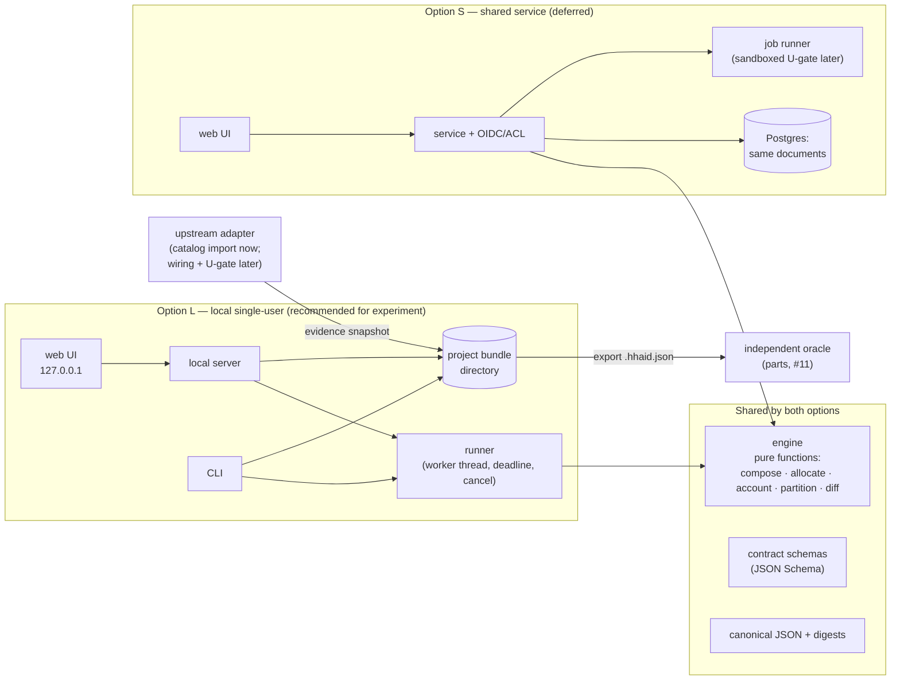

# D05: Runnable architecture for the first BOM experiment

| | |
| --- | --- |
| Issue | [#12](https://github.com/afewell-hh/hh-aid/issues/12), assignment [6786444569](https://github.com/afewell-hh/hh-aid/issues/12#issuecomment-6786444569) |
| Author | t7 / arch (AI agent). Not self-approved. |
| Independent reviewer | lead. A focused bridge or model check is requested only for a specific unresolved contract conflict. |
| Status | **Revision 2.** Lead [accepted](https://github.com/afewell-hh/hh-aid/issues/12#issuecomment-6786859007) option L, the immutable documents with self-contained export, and the one-profile extractor **as the experiment basis**. That acceptance is subject to the implementation gates G-A to G-D in §13. It is not production adoption, and the runtime versions named here are observations to re-verify at scaffold time. ADRs in [`docs/adr/`](../adr/) carry the same status. |
| Date | 2026-11-10 |
| Base | main `4c71aa5`: the [brief](../first-bom-experiment.md) and the [checkpoint](../design-checkpoint.md) |

Labels: **F** observed fact (source read or command run); **D** documented by an accepted artifact or upstream; **I** inference; **H** proposal; **Q** open question.

## 1. Decision summary

1. **H — Run the experiment as a local, single-user application:**
   - one TypeScript workspace;
   - a pure deterministic engine;
   - a filesystem project store;
   - a CLI for headless acceptance;
   - a local web UI served on `127.0.0.1`.

   The shared-service path (§3, option S) reuses the same engine, the same documents and the same export format. It adds hosting, identity, concurrency and a job runner, none of which tests the experiment's domain risk.
2. **H — A project is a set of immutable, content-addressed documents.** These are input revisions, evidence snapshots, output revisions, diffs, reviews and stage results, written as canonical JSON. All of them are rooted in an immutable `ProjectIndex` chain whose current ID sits in an atomically replaced `HEAD`. Staleness is derived when read, never stored. The export is a single self-contained, closure-checked JSON file. Reimporting then exporting must give byte-identical output.
3. **H — `generate` is a pure function:**

   ```
   generate(input revision, evidence snapshots, rule/engine version) → output revision
   ```

   It takes no clock, randomness, network or environment input. The run configuration, including its deterministic operation budget, is an explicit input. The output revision carries a semantic digest. Wall-clock deadlines and user cancellation belong to a separate **runner** that hosts the engine in a worker thread (§9.1). They never enter domain steps.
4. **H — The oracle reads only the export.** parts' acceptance projection ([#11 kickoff](https://github.com/afewell-hh/hh-aid/issues/11#issuecomment-6786515040)) is computed from the exported file by a test adapter. It never reads internal storage and never imports engine code.
5. **D — The first slice emits no Hedgehog wiring, so the R03 U-gate does not apply yet.** Where a later step emits wiring, it adds the pinned U-gate with the [R03 import controls](https://github.com/afewell-hh/hh-aid/blob/2b547901413c00fb8d7ce3eeff7d6669f2b78135/docs/research/upstream-reuse.md). That gate never blocks the conditional BOM. This follows [D01 §4](https://github.com/afewell-hh/hh-aid/blob/3d313fe/docs/design/domain-model.md): BOM usefulness does not require a wiring export.

## 2. Inputs used (linked, not copied)

| Input | Exact revision | Used for |
| --- | --- | --- |
| Brief and checkpoint | main `4c71aa5` | Demonstration steps, scope, deferrals |
| Server-class contract (#25) | `365a0c3` | Class, revision, customization, population and occurrence identity; composition rules §5 |
| Server-unit BOM (#26) | `0230cd8` | Installed vs purchase lines; inclusion; shared assemblies |
| Port-allocation contract (#29) | `d97a2ef` | Group, binding and expansion entities; three accounts (AC1); determinism §4; connection classes §5 |
| Allocation patterns (#30) | `a60134f` | Selector fixtures and negative cases |
| Fabric/profile and release evidence (#28) | `31779de` | Catalog provenance (§4.1), support vocabulary (§4.3), RC-1 to RC-7 |
| D01 domain model (#23) | `3d313fe` (draft context) | AnswerRecord states, regeneration contract, revision manifest, ValidationRecord |
| R03 upstream reuse (#18) | `2b54790` | U-gate and import controls; catalog-export seam; Go coupling |
| Screens (#27) | `d1fd01f` | UI scope; static direction only |
| Peer drafts (not yet reviewed) | #10 topo: manifest [`9aa448a`](https://github.com/afewell-hh/hh-aid/blob/9aa448a32deb62f57629ac0e5f3480ba95faab7d/docs/design/first-bom/scenario.json) (sha256 `9200061e…d723`, per parts) and packet [`ce4b8e6`](https://github.com/afewell-hh/hh-aid/blob/ce4b8e6b03f79b8aa4ff796e8b4460ebc67312a8/docs/design/topology-engine.md). #11 parts: [`3261186`](https://github.com/afewell-hh/hh-aid/blob/32611864af40ee6bd7ef671622d534d3bc7b2d65/docs/design/verification-strategy.md). | Manifest, staged engine interface, oracle and harness (§6) |

## 3. Two viable options



| Concern | **L: local single-user** (H, recommended for the experiment) | **S: shared service** (H, deferred) |
| --- | --- | --- |
| Runs as | `npm ci && npm run app` on an SE laptop. UI and API on `127.0.0.1`. CLI for headless runs. | A hosted web service with server-side engine, database, workers and SSO |
| Persistence | Project bundle directory of immutable canonical JSON documents (§4) | The same documents as rows (for example Postgres `jsonb` keyed by digest), plus object storage for large artifacts |
| Identity and authorization | A local actor name recorded in audit entries. No authentication: the OS user owns the files. | OIDC SSO through a Hedgehog IdP (Q); per-project roles for SE, partner SE and reviewer; partner tenancy (Q) |
| History and concurrency | Linear revisions. One writer, enforced by a lock file. | Optimistic concurrency on the head revision. A stale parent produces a three-way merge per D01 §3, never last-writer-wins. |
| Jobs | The engine runs in a local `worker_threads` worker that can be terminated for a deadline or a user cancel (§9.1). The main thread stays responsive. | Queue plus workers. The U-gate runs in disposable sandboxes with a scrubbed environment and no network (R03 A1). |
| Data sensitivity | Customer topology stays on the SE's machine and in exported files. No telemetry and no egress. | Central custody of customer data: needs a data classification, retention, encryption and partner-access policy (Q, sponsor) |
| Catalog refresh | Explicit import of an evidence-snapshot file, then an impact review (RC-2, RC-3, RC-7) | The same import, plus optional scheduled discovery that notifies but never mutates (RC-7) |
| Cost and risk | Low. No infrastructure. Its gaps (collaboration, starter-library sharing, central audit) are known and deferred by the brief. | High. Hosting, IdP integration, security review, operations and backup. None of it de-risks BOM correctness. |
| What it proves | Domain behavior, determinism, export/reimport and the oracle loop | Collaboration and governance; untestable until L proves the engine |

**Migration path from L to S.** The engine, schemas and export format are unchanged. Only two things are replaced: the store implementation and the shell around the engine (§7). An S deployment imports L exports. The export is therefore the compatibility contract between the two options, and it carries a format version from the first commit.

**A rejected variant (I).** A static, browser-only application using IndexedDB or the File System Access API would remove the local server. It was rejected for the experiment because:
- browser storage can be evicted;
- the File System Access API is not available in every browser;
- headless acceptance would still need a separate runtime.

### 3.1 Stack recommendation (H; ADR-0001)

| Choice | Proposal | Reasoning |
| --- | --- | --- |
| Language | TypeScript (strict) for engine, store, CLI, server and UI | One language across UI and engine; the engine can later run in a browser worker or on a server unchanged. The static screens are already HTML. Python is left to parts' oracle, which keeps implementation diversity (§6). Go is kept for the upstream adapter only (§5), consistent with R03 option E's coupling boundary. |
| Runtime | Node.js LTS, pinned in `.nvmrc` and `engines`. **F (2026-11-10):** the current LTS line is 26.x "Lithium" (`v26.13.0`, 2026-10-28, nodejs.org dist index). This machine has a non-LTS `v23.11.0`. | LTS stability. The spike must not depend on the developer's ambient Node. |
| UI | React with Vite. Screens follow #27 `d1fd01f`. | Mainstream and agent-friendly. React escapes text by default, which mitigates script injection from free-text fields (§8). |
| Server | Node `http` or a minimal router, JSON API only | No framework is needed for a single-user local API |
| Contracts | JSON Schema 2020-12 files, validated with Ajv | Language-neutral, so parts' Python oracle can validate the same export. TS types are derived from or checked against the schemas. |
| Tests | Vitest (unit and golden), fast-check (property), Playwright (UI steps of the brief's demonstration table) | Each demonstration row becomes an executable test |
| Package hygiene | npm with a committed lockfile; `npm ci`; exact versions; dependencies at least 14 days old when pinned; install scripts disabled except for allow-listed packages | Supply-chain risk on a laptop holding customer data. **F (2026-11-10):** `vite@8.3.8` was published today and would fail the age rule. |

## 4. Project persistence, export and reimport (H; ADR-0002)

**Documents.** Every document is canonical JSON (§4.1) and immutable once written. A document is identified by `sha256` over its canonical bytes.

| Document | Content | References |
| --- | --- | --- |
| `ProjectIndex` | Format version, project ID, previous index ID (or none), current input head, and **root lists**: input revisions in chain order, then output revisions, review records, evidence snapshots, diff records and stage results (§9.1), each sorted by ID | Every document in the project is reachable from the current index |
| `InputRevision` | Full project state at revision *n*: classes, customizations, populations, answer records (D01 §3 states including typed `unknown`), allocation-group bindings, reservations, locks, commitments, manual notes, identity registry (D01 §5), scenario seed reference | Parent revision ID, evidence snapshot IDs, scenario manifest hash |
| `EvidenceSnapshot` | Switch-profile subset, assembly/part catalog entries, support status (#28 §4.3), each with origin (`extracted` / `manual-transcription` / `local-modified` / `manual` / `placeholder`), source permalink and source content hash | None. Content-addressed and shared across revisions. |
| `OutputRevision` | Run configuration and outcome (`complete` / `limit-reached`), BOM lines (installed, purchase, coverage, unresolved inclusion), assembly IDs and end maps, named missing infrastructure, the configured-resource ledger kept separate from selected/assigned counts, sizing tagged `exact-conditional` / `bound` / `unresolved`, connection-class rows, conflicts and diagnostics | Input revision ID, evidence IDs, engine and rule version. **No staleness and no diff**: both are derived later. |
| `DiffRecord` | Semantic diff between two outputs (D01 §5 contents) | The *from* and *to* output IDs; computed by the pure `diff` |
| `ReviewRecord` | Manual inspection: represented member set, inspected fields, scope `field/member/revision`, notes (#29 §2) | Output revision ID and row signature |
| `AuditEntry` | Actor, wall-clock time, action, document IDs, run timings | Append-only log, **excluded from every digest and from reachability** |

**Revision model.** Each save writes a full `InputRevision` snapshot, not a delta. That is the simplest deterministic choice at experiment scale (§9). Generation writes a new `OutputRevision`. Earlier outputs and reviews are never rewritten.

**Staleness is a view, not history.** `assess(index, documentID)` is a pure read-time function. Its results are:
- an output is `current` or `stale`, with a reason: a different input head, superseded evidence, or a changed engine or rule version;
- a review is `retained within unchanged scope`, `needs review` or `invalidated` (D01 §3), by comparing its row signature with the current output.

These assessments are never written into a hashed document. If a recorded assessment is ever needed, it becomes a new document that references what it assessed.

**On disk.** The local store layout is:

```
<project>.hhaid/
  HEAD                 # the ID of the current ProjectIndex
  docs/<sha256>.json   # every immutable document, including indexes
  audit.log
  LOCK
```

**Atomic update.** A save or generate follows this sequence:
1. write each new document to `docs/` (temporary file, `fsync`, rename; existing digests are skipped);
2. write a new `ProjectIndex` that references the previous index and lists the new roots;
3. atomically replace `HEAD` (temporary file, `fsync`, rename). This rename is the single commit point.

If the process crashes before step 3, it leaves only unreferenced files. `hhaid fsck` reports them, and they are never loaded as part of the project. On open, the store verifies `HEAD`, the index chain and every digest it reads.

**Export.** One file, `<project>.hhaid.json`:

```
{ format, head: <index ID>, documents: [...the closure of the index chain, sorted by digest] }
```

The closure includes every index in the chain, every root, and everything those roots reference. The export is canonical. It carries no audit log by default; including it is an option, because it holds actor names.

**Reimport** validates in this order, and rejects the file on any failure:
1. size cap;
2. strict JSON parse with the number rule in §4.1;
3. schema validation per document;
4. digest recomputation;
5. closure: `head` resolves, the index chain is acyclic, and every root and reference resolves inside the file;
6. **no unreachable extra documents**, so a crafted file cannot carry unlisted content;
7. consistency: input parents are in the chain, outputs and diffs reference listed inputs and outputs, and reviews reference listed outputs;
8. rejection of any unknown format version or unknown field.

Import writes into a clean store and then sets `HEAD`. Format migration is a later, explicit, copy-based operation (D01 §5).

**Round-trip acceptance test** (in `experiment-check lifecycle`):
1. Build a project with inputs r1 and r2, outputs o1 (from r1) and o2 (from r2), a diff o1→o2, and a review on an o1 row.
2. Export it, import it into a clean store, and export again.
3. Check the following:
   - the two exports are byte-identical;
   - o1, the review and the diff are present and unchanged;
   - `assess` reports o1 `stale` and the review `needs review` or `invalidated`, per its row;
   - regenerating r2 reproduces o2's semantic digest.

**Scenario seed.** topo's `docs/design/first-bom/scenario.json` (#10, `FB-01/r1` at `9aa448a`) is imported by its exact commit and content hash into a new project's first `InputRevision`. The application never edits the manifest file. The importer rules are:

- Manifest JSON `null` means *unresolved, with the reason in its record* (topo §"Deterministic interface"). It becomes a typed unknown with provenance `manifest:<path>`, never `0`.
- `author_expected` and every `expected` and `expected_delta` field are **ignored** by the importer, so the engine never sees reference answers.
- Each `mutations[]` entry becomes a scripted edit producing a new revision. Mutations are not separate projects, except the `synthetic_only` cases (FB-AC1, FB-EVIDENCE), which seed their own synthetic evidence.

### 4.1 Determinism and canonical form (H)

- **Canonical JSON** follows the RFC 8785 rules. Floats are forbidden in content: quantities are integers, and any ratio is `{num, den}` with `den > 0`. Units are explicit strings. Unknown is `{"state":"unknown", ...provenance}`, never `0`, `null` or omission.
- **Safe integers only.** Every quantity and every ratio term must satisfy `Number.isSafeInteger` (|n| ≤ 2^53 − 1).
  - **Import:** the check runs on the **source token text**, before or alongside `JSON.parse`, because `JSON.parse` silently rounds values such as `9007199254740993`. A token with a fraction, an exponent, `-0`, or a value outside the safe range is rejected with its JSON path.
  - **Arithmetic:** every multiplication or addition in the engine (population × per-unit × nested quantity) is checked. Overflow produces a typed `unresolved` result with a `quantity-overflow` diagnostic. It never produces a rounded number, and BigInt is not silently substituted.
  - **Test vectors:** `9007199254740993`, `1e3`, `1.0`, `-0`, a ratio with `den: 0`, and a product that overflows.
- **Collection order.** Every array is either semantically ordered (for example selector order, #29 §3) or sorted by stable ID, comparing UTF-16 code units. `localeCompare` and container iteration order are never used.
- **Derived IDs** come from stable *input* IDs plus role and occurrence key. For example, an assembly ID is derived from the demand ID, the pairing rule and the occurrence key. Derived IDs never come from labels, SKUs or other mutable attributes (D01 §5). New user-entity IDs are opaque and are stored as data. Tests inject a seeded ID source.
- **Two digests.** The `semanticDigest` is computed over the `OutputRevision` content, which includes the run configuration. The `byteDigest` is computed separately over each rendered artifact (CSV, Markdown). Run metadata such as duration, host, time and deadline outcome goes in `AuditEntry` only.
- **Check:** generate twice, in two processes, with shuffled document load order. The semantic digests must be identical.

## 5. Evidence snapshots, catalog refresh and adapter boundary

**Catalog snapshots (H, implementing RC-2, RC-3 and RC-7).** An `EvidenceSnapshot` is produced only by an explicit import of a file. Each profile entry records Fabric release and commit, profile name, source permalink and a content hash, because `SwitchProfile` has no version field (#28 §4.1).

**DS5000 profile for the experiment (approved by lead, 6786859007).** topo's manifest names the profile and its source path but carries no port, mode or pipeline content. parts' oracle hand-derives the resource grouping in Python (`check_fb01.py`). The engine's snapshot is therefore machine-extracted, so the two sides stay independent.

The tool is a **one-shot extractor for one profile** at `spikes/first-bom/tools/profile-export/`:
- `go.mod` requires `go.githedgehog.com/fabric v0.144.1`. The toolchain and module pins are verified as downloadable at scaffold time, not assumed from this document.
- It serializes only the compiled `celestica-ds5000` profile to JSON.
- Its provenance file records the command, toolchain, Fabric tag and commit, the source file's git blob SHA, and the output sha256.
- The JSON output is committed with origin `extracted`. The application and the acceptance run consume only that JSON and never need Go. Rerunning the extractor is an optional drift check.

**Fallback.** If the extractor cannot be built, a hand-transcribed subset is used instead. Its origin is `manual-transcription`, and it records the source blob SHA and the transcriber. Before use, a reviewer other than the transcriber and other than parts' oracle author checks it field by field against the pinned source, and that check is recorded in #14. parts' oracle stays independent of either path.

**Deferred (not approved):** broad catalog tooling. That means all profiles, Supported Devices extraction, per-release automation and R03 X5 as a whole.

**Refresh**, as the brief's "Refresh evidence" step, means:
1. import a controlled revised snapshot fixture;
2. compute the impact set: lines, rows and reviews whose dependencies reference changed entries;
3. mark them stale;
4. let the user regenerate a candidate revision.

Historical outputs keep their old snapshot IDs. The experiment performs no network discovery and invents no new Hedgehog release. RC-1 discovery is deferred.

**Upstream adapter boundary (H).** The `upstream/<fabricator-tag>/` adapter package has a fixed responsibility list:

| Responsibility | Experiment | Later |
| --- | --- | --- |
| Profile catalog → `EvidenceSnapshot` | The one-profile `celestica-ds5000` extractor output (or the checked `manual-transcription` fallback), committed JSON with provenance as described above | Broad catalog tooling (all profiles, per-release automation; R03 X5). The application consumes JSON only, so Go never enters the app runtime. |
| Support status per release | From #28 §4.3 evidence, as data | Supported Devices extraction per release |
| Wiring emitter | **Not present** | Per-release emitter of unhydrated YAML from an `OutputRevision`, with registry name mapping (D01 §5) |
| Validation gate | **Not present** | Pinned release-binary U-gate with the R03 §3.1 controls: delimiter rejection, byte identity, scrubbed environment, no network, and binary/config/wiring provenance. Results are `ValidationRecord`s (D01 §6). It never gates a BOM-only output. |

The engine depends on adapter *output documents*, not on adapter code. A Fabricator release change produces a new adapter directory and new snapshots, never an edit to an old one.

## 6. Interfaces with #10 (topo) and #11 (parts)

Kickoff assumptions are in [#12 6786524084](https://github.com/afewell-hh/hh-aid/issues/12#issuecomment-6786524084). I checked them against the peer drafts in §2 and found **no blocking conflict**. Lead confirmed the reconciliations below in 6786859007.

| Interface | Contract (H) | Status against peer drafts |
| --- | --- | --- |
| Scenario manifest | Consumed by exact commit and sha256. `null` becomes a typed unknown. Reference answers are ignored (§4). | Compatible with `FB-01/r1`. topo says the manifest is "not a full project serialization format; arch defines transport/persistence" (ce4b8e6 §Deterministic interface), and that is what §4 does. |
| Engine stages | topo's staged constructive method is implemented as `engine` functions in the order: identity and reference validation → per-unit expansion → whole-switch configured ledger → selection/reservation → construction units → conditional bounds and witness → acquisition lines → connection review → diagnostics. Derived IDs follow topo's `(scenario, occurrence, component slot)` rule, which matches §4.1. | Compatible. Its output records (result envelope, acquisition line, sizing result, diagnostic, connection review) map one-to-one onto `OutputRevision` sections. |
| Bounded run | Named run configurations (§9.2). topo's limits are the `interactive` configuration. A separate `scale` configuration covers parts' 20,000–50,000-demand probe. An operation-budget limit yields a deterministic `limit-reached` result. A deadline or user cancel yields `interrupted`, handled by the runner (§9.1). Neither result means `infeasible`. | Compatible. The limits are unmeasured proposals that parts reviews. |
| Acceptance projection | `spikes/first-bom/tests/adapter/` reads only `<project>.hhaid.json` and writes parts' projections: the `fb01` baseline/`count_A3` shape for `check_fb01.py --actual`, and the case-keyed AC1 object. Typed unknown appears as JSON `null` **only in the projection**, which is parts' convention, for example `"configured_total": null`. The adapter adds no facts and never reads expected files. | Compatible with parts 3261186 §"Proposed adapter boundary" |
| Harness names | parts proposed `experiment-check generate|lifecycle|verify|measure`, and topo proposed `validate-input`, `generate`, `diff`, `export/reimport`. The proposal splits ownership: the **application CLI** `hhaid validate-input|new|seed|edit|generate|diff|export|import|refresh` is arch's; the **harness** `experiment-check` subcommands are thin scripts that drive `hhaid` and then call parts' Python checkers. `verify` and `measure` stay parts-owned. | **Confirmed by lead** ([6786859007](https://github.com/afewell-hh/hh-aid/issues/12#issuecomment-6786859007)), together with the `null` mapping, the exclusion of author answers and the export-only adapter |
| Expected results | parts' frozen files under `docs/design/first-bom/verification/`, citing the manifest sha256. They are never generated from engine output. | Compatible |

**Acceptance commands (proposed; not yet runnable):**

```sh
cd spikes/first-bom && npm ci
npm test                                              # unit, golden and property tests
npm run sources:verify                                # sources.lock: every pinned blob present
./experiment-check generate  --manifest M --export D  # hhaid seed+generate+export → adapter projection
./experiment-check lifecycle --manifest M --workdir W # save, stop, reopen, export, import into a clean store, regenerate; mutations FB-DPU…FB-EVIDENCE
./experiment-check verify    --expected E --actual D  # parts: check_fb01.py --actual, check_ac1.py
./experiment-check measure   --manifest M --config scale --repeats 5 # parts' protocol (verification-strategy §measurement)
npm run test:runner                                   # §9.1 T1–T5 and the §9.2 cap, budget and scale tests
npm run determinism                                   # two-process, shuffled-order semantic-digest equality; export round-trip bytes
npm run e2e                                           # Playwright: one test per row of the brief's demonstration table
```

**Integration of accepted artifact commits.** The accepted artifacts stay on their PR branches. The spike commits `spikes/first-bom/sources.lock.json`, which lists `{artifact path, commit, blob sha}` for each checkpoint input plus the #10/#11 commits. `npm run sources:verify` runs `git cat-file` to verify every blob, and every `experiment-check` subcommand runs it first. Nothing is merged or copied merely to satisfy the build. Merge decisions remain with lead.

## 7. Component contracts (H)

| Component | Owns | Must not |
| --- | --- | --- |
| `engine` | Stages S1–S5 (§9.1): `compose`, `account`, `ledger`, `expandSelection`, `size` (topo's method), `partition` (connection classes); plus the pure `diff`, `impact` and `assess` functions | Do I/O, read the clock or randomness, await, check signals, sort by locale, or fill in unknowns |
| `runner` | Worker lifecycle, deadline and cancel, persisting stage results, `PartialCandidate` records | Contain domain logic or alter stage results |
| `contracts` | JSON Schemas, canonical serializer, digests | Contain domain rules |
| `store` | Filesystem bundle, `LOCK`, atomic `HEAD` commit, index chain, digest verification, closure-checked export/import, `fsck` | Interpret domain content beyond schema validation, or rewrite a stored document |
| `cli` | `new`, `seed`, `edit` (scripted patch), `generate`, `export`, `import`, `diff`, `refresh` | Contain logic that the UI lacks. Both call the same functions. |
| `server` | Local JSON API, bound to `127.0.0.1` only | Listen on other interfaces, make outbound calls, or serve files outside the bundle |
| `ui` | Screens per #27: editing, BOM expand/collapse, connection-class review, diff and stale views | Compute quantities. The UI displays engine output only. |
| `tests/adapter` | Export → parts projection | Import `engine` |

## 8. Security, trust boundaries and data handling

**Trust boundaries (experiment).** The local OS user is trusted. All of the following are untrusted input:
- imported `.hhaid.json` files and evidence snapshots;
- the scenario manifest, until its hash matches the lock;
- free text: descriptions, notes, part names.

**Controls (H, in the experiment):**
- strict schema validation and an import size cap;
- digest verification;
- no code or template evaluation of any content;
- a single-file export, so there are no archive path-traversal cases;
- server bound to loopback with a per-session token, so other local web pages cannot drive the API (CSRF and DNS rebinding);
- UI text rendered escaped;
- a **CSV export that prefixes cells beginning with `=`, `+`, `-`, `@`, tab or carriage return**, preventing formula injection in spreadsheet tools;
- no secrets exist or are stored in the experiment;
- only synthetic fixtures in the public repo, per AGENTS.md;
- user projects written outside the repository by default; the `.gitignore` rule `*.hhaid*` is a backstop.

**Later wiring.** If a later step emits wiring, the R03 A1 template-injection controls are mandatory before calling `hhfab init`.

**History and audit.** Immutable revisions plus the append-only audit log give attributable history for a single user. They are not tamper-evident against the file owner, which is acceptable locally and insufficient for shared governance (S).

**Deferred decisions (sponsor and lead; Q):**
1. Where customer topology data may live, and its classification.
2. Partner-SE access and tenancy.
3. IdP and role model.
4. Retention and deletion periods.
5. Encryption at rest for hosted storage.
6. Signed or tamper-evident revisions for approvals.
7. Starter-library publishing workflow and trust.
8. Hosting owner and operations.
9. Export of approval records to procurement.

None of these blocks the experiment.

## 9. Scale, jobs and observability (bounded)

- **Scale (I).** The experiment scenario has tens of entities. Full-snapshot revisions are proportionate. D01's aggregate demand IDs ("N links of class K in group G") avoid expanding per-link records where the claim allows it. The thresholds that would trigger chunked or indexed storage (SQLite locally, Postgres in S) and UI virtualization come from parts' measurements (#11), not from assumption.
- **Observability.** Each run writes an audit entry with input and evidence digests, run configuration, engine version, per-stage durations, outcome, and counts of conflict and unresolved results. There is no remote telemetry.
- **Later wiring validation.** R03's upstream comment that U-gate cost is quadratic is why later wiring validation is batch-only and goes through the same runner.

### 9.1 Execution contract: stages, runner and cancellation (correction A)

**Pure stages.** `generate` is a fixed sequence of pure, synchronous stage functions, following topo's staged method (§6):

| Stage | Produces |
| --- | --- |
| S1 | Identity and reference validation; per-unit expansion and component accounting, giving server, attachment and missing-infrastructure lines |
| S2 | Whole-switch configured ledger |
| S3 | Selection and reservation |
| S4 | Construction units, conditional bounds and witness |
| S5 | Switch-side and assembly acquisition lines, connection review and diagnostics |

Each stage is a pure function of the input revision, the evidence, the run configuration (§9.2), the engine version and earlier stage results. Each one returns a `StageResult` document. Its content-addressed key is the digests of those inputs plus the stage ID. When every stage has completed or deterministically stopped, the `OutputRevision` is assembled from the stage results.

The stages contain no timers, no `await`, no clock and no signal checks. The run configuration's **operation budget**, meaning counters of demand terminations, candidate switches and candidate inspections, is checked inside the stages. Because those counts depend only on the inputs, `limit-reached` is a deterministic result.

**Runner (outside the domain).** The runner, used by both the CLI and the local server, starts one Node `worker_threads` worker per run and passes it canonical documents. The worker posts each `StageResult` as soon as it finishes, and the main thread persists it immediately. Deadlines and user cancels (`POST /runs/{id}/cancel`, Ctrl-C, or `--deadline`) are timers on the **main thread**, and they act by calling `worker.terminate()`. That gives preemptive cancellation without the engine yielding control, and the main event loop stays free to serve the UI.

**Cooperative chunking was rejected** for this reason: it would put async yields and time checks inside domain steps. A browser build would use a Web Worker in the same role.

**What is persisted after each outcome:**

| Outcome | Determinism | Persisted | Never |
| --- | --- | --- | --- |
| `complete` | Yes | An `OutputRevision`, rooted in a new index | — |
| `limit-reached` (operation budget) | Yes | An `OutputRevision` with `outcome: limit-reached`. The stages before the limited stage are complete, so the S1 component and missing-infrastructure lines are always present. The limited stage reports `unresolved: limit-reached` with no partial assignments. Dependent sections are `unresolved-dependency`. | Partial assignments presented as a plan; "infeasible" |
| `interrupted` (deadline or user cancel) | Timing-dependent, so it is **not an output** | A `PartialCandidate` document, rooted in a new index. It holds the input and evidence IDs, the configuration, the IDs of completed `StageResult`s, `outcome: interrupted` and a reason (`deadline` or `user-cancel`). It contains no time; time goes to the audit log. The UI shows its S1 lines labelled *"partial: generation interrupted; no allocation or sizing claim"*. | An `OutputRevision`, a semantic digest, a sizing or assignment claim, or any change to existing outputs |
| Worker crash or error | — | Same as `interrupted` with reason `error`, and the error goes to the audit log | Same |

In every case, existing outputs, reviews and the previous index are untouched. A rerun with an identical key reuses the completed `StageResult`s; that is exact-dependency caching per D01 §3.

**Executable cancellation tests** (in `npm test` and `experiment-check lifecycle`). The thresholds are provisional and recorded:

| Test | What it checks |
| --- | --- |
| T1 deadline | Run the scale fixture with the `interactive` configuration and a runner deadline of 50 ms. Expected: outcome `interrupted`; the worker terminates within 1 s of the deadline; one new `PartialCandidate`; no new `OutputRevision`; all earlier document bytes unchanged. |
| T2 responsiveness | During a long run, `GET /health` on the local API responds within 200 ms |
| T3 user cancel | Cancel through the API mid-run. Same assertions as T1, with reason `user-cancel`. |
| T4 stage determinism | `StageResult`s saved by an interrupted run are byte-identical to the same stages from a complete run |
| T5 resume | After an interruption, a rerun completes, and its `OutputRevision` semantic digest equals that of an uninterrupted run |

### 9.2 Run configurations and limits (correction B)

A run configuration is an input. It has an ID and explicit values, and it is recorded in the `OutputRevision` (and therefore in its semantic digest) and in the audit log. The values below are **provisional and unmeasured**. They change only by lead decision, with parts' evidence.

| Configuration | Demand terminations | Candidate switches | Candidate inspections | Runner deadline | Purpose |
| --- | --- | --- | --- | --- | --- |
| `interactive` (default) | 10,000 | 256 | 2,000,000 | 5 s | topo's proposed limits for UI use |
| `scale` | 100,000 | 8,192 | 250,000,000 | 120 s | parts' 20,000–50,000-demand probe, with headroom |

Basis for the `scale` values (I, arithmetic only): FB-01 has 24 attachment demands. 50,000 demands ÷ 24 ≈ 2,084 disjoint replicas, and two conditional leaf contexts per replica gives ≈ 4,168 candidate leaf occurrences. Even an unpartitioned naive check, about 50,000 × 4,168 ≈ 2.1 × 10⁸ inspections, fits inside the budget. The deadline is deliberately far above parts' 10 s investigation threshold, so a slow run is *measured* rather than truncated.

The limits gate S2 to S5 only. S1 is linear and is bounded by the import size cap and the safe-integer rule, so component lines are always produced.

**Separate tests:**
- **Cap rejection.** The `interactive` configuration on the scale fixture gives `limit-reached` at the S3 demand-termination check. The test asserts the S1 lines are present and identical across two runs.
- **Budget limit.** A tiny inspection budget on FB-01 gives `limit-reached` in S4, with the same digest on two runs.
- **Scale success.** The `scale` configuration on the scale fixture gives `complete`, with independent member conservation per parts' protocol. `experiment-check measure --config scale --repeats 5` records five individual samples, the median and the maximum. No measurement is claimed here.

## 10. Ordered implementation sequence (for #13 synthesis and #14 dispatch)

Each step ends with tests passing. Steps 3 to 7 each close specific rows of the brief's demonstration table.

| # | Step | Depends on | Done when |
| --- | --- | --- | --- |
| 0 | Scaffold `spikes/first-bom/`: workspace, pinned Node LTS, lockfile, scripts, `sources.lock.json` with verification | This packet accepted | `npm ci && npm test` pass; the lock verifies accepted blobs |
| 0b | DS5000 evidence snapshot: one-profile extractor output (or the checked `manual-transcription` fallback) committed with provenance (§5) | 0 (approved) | Snapshot and provenance sha256 recorded; any fallback check recorded in #14; parts' oracle unchanged |
| 1 | `contracts`: schemas, canonical JSON, digests, safe-integer token check | 0 | Golden canonicalization vectors; float, unknown and unsafe-integer rejection tests (§4.1) |
| 2 | `store` and `cli`: new, seed, save, reopen, index chain, atomic `HEAD`, export, import, `fsck` | 1, 0b; manifest `9aa448a` (or its accepted successor) | Create/save row; `null` → typed unknown; closure and extra-document rejection; crash before `HEAD` leaves the project unchanged |
| 3 | Stage S1 (`compose`, `account`) for server and attachment lines only, plus the `runner` with T1–T5. Switch and media lines are `unresolved` and named. | 2; parts' expected server lines | Generate and inspect rows pass against parts; DPU customization row; cancellation tests pass |
| 4 | Thin UI over steps 2 and 3: class editor, BOM expand, save/reopen | 3 | Playwright create/customize/generate/inspect |
| 5 | Stages S2–S4 (`ledger`, `expandSelection`, `size` with topo's D03 method), AC1 and unknown-mode cases, and the §9.2 configurations | 3; **D03 sizing contract** | Define destination and explain failure rows; cap and budget tests |
| 6 | Stage S5 (`partition`, connection classes), review records, `assess` | 5 | Inspect row; manual note scope; review applicability derived, not stored |
| 7 | `diff` (`DiffRecord`), `impact`, `refresh` with the controlled catalog revision | 6 | Refine/regenerate and refresh-evidence rows; determinism script; full round-trip test with an older output and a review (§4) |
| 8 | Acceptance run and parts' performance probe; handoff | 7 | Every §6 acceptance command passes, including the §9.1 cancellation tests and §9.2 cap/scale tests; the independent check is recorded by parts |
| — | **Not in this sequence:** broad catalog tooling (all profiles, Supported Devices, per-release automation; R03 X5 beyond the one approved profile), wiring emitter, U-gate, option S | — | Separate authorization |

**Material risks:**
1. **The engine invents domain rules where contracts are silent.** Mitigation: unspecified cases produce a typed `unresolved` with a named dependency, and the gap is raised to lead.
2. **D03 sizing arrives late.** Mitigation: steps 3 and 4 deliver useful server and attachment BOM lines with switch lines visibly unresolved, as the brief allows.
3. **Common-mode error between engine and oracle.** Mitigation: separate language, no shared code, and expected results derived from the manifest only.
4. **JavaScript determinism pitfalls** (key order, locale sort, floats). Mitigation: §4.1 plus property tests.
5. **Experiment code read as production.** Mitigation: it lives under `spikes/`, and its README states it is not production.
6. **Dependency supply chain.** Mitigation: §3.1 hygiene.
7. **Evidence currency.** The 26.05 profile evidence is dated 2026-11-08. Outputs display the snapshot date, and "current" is never claimed (RC-4).

## 11. Coverage ledger for #12's original acceptance criteria

| Criterion | This packet | Deferred |
| --- | --- | --- |
| Context/component diagrams, contracts, two or more alternatives | **Covered** for the experiment: §3, §7; options L and S | Production context diagram including the IdP, hosting and procurement systems |
| Trust boundaries, authorization, audit, history, input safety, secrets, retention/export | **Covered** for local single-user: §4, §8 | Shared-service authorization, retention, encryption and tamper evidence: §8 Q1–Q9 |
| Large graphs, async jobs/cancellation, deterministic builds, observability, upstream adapters | **Partly covered:** determinism and safe integers §4.1; runner, cancellation and partial results §9.1; run configurations §9.2; observability §9; adapter boundary §5 | Storage thresholds and navigation at scale (await #11 measurements); wiring adapter and U-gate runner; job queue |
| ADRs with decision owners, dependencies and experiment criteria; fit with D02/D03/D04 | **ADR-0001 and ADR-0002 accepted for the experiment basis**, subject to gates G-A to G-D (§13). Fit with D02 (#27 screens) by construction. Fit with D03/D04 is **checked against their unreviewed drafts** (`9aa448a`, `ce4b8e6`, `3261186`): no blocking conflict; reconciliations listed in §6. | Final ADR acceptance after the experiment; recheck if #10/#11 change in their correction rounds |
| F/D/I/H/Q separation, versions, reproducible evidence | Labelled throughout. Toolchain and package observations dated 2026-11-10. | Executable reproducibility arrives with step 8 |
| Independent disposition; sponsor decisions | Requested: lead review | Sponsor decisions §8 Q1–Q9; deployment model |

## 12. Checks performed and not performed

**Performed (F):**
- read the brief, the checkpoint and the inputs in §2 at the cited commits;
- queried the nodejs.org dist index and npm registry metadata (2026-11-10);
- recorded the local toolchain: Node v23.11.0, npm 10.9.2, Go 1.24.1, Python 3.9.6, darwin/arm64;
- checked markdown links to repository paths.

- read the #10 manifest and packet and the #11 strategy and checkers at the commits in §2, without running them;
- revision 2: rechecked that the #10 and #11 branch heads were unchanged (`ce4b8e6`, `3261186`) before editing.

**Not performed:** no code was written or run for the application; no scaffold, prototype, extractor, runner or performance measurement was made. parts' checkers were not run. The §9.1 and §9.2 thresholds and the `scale` values are unmeasured. There was no maintainer or sponsor contact.

## 13. Implementation gates recorded with the experiment-basis acceptance

These come from lead's correction request [6786859007](https://github.com/afewell-hh/hh-aid/issues/12#issuecomment-6786859007). The build (#14) must meet each gate with the named executable evidence before claiming it.

| Gate | Requirement | Evidence |
| --- | --- | --- |
| G-A Execution | Pure stages; worker runner; deadline and cancel outside the domain; partial-result rules | §9.1 T1–T5 |
| G-B Limits | Named `interactive` and `scale` configurations recorded in outputs; cap rejection tested separately from scale success; five measured samples | §9.2 tests; `experiment-check measure` |
| G-C Closure and history | `ProjectIndex` roots; atomic `HEAD`; strict closure on reimport; staleness derived; safe integers only | §4 round-trip test; §4.1 vectors; `fsck` crash test |
| G-D Evidence provenance | Committed one-profile extraction with provenance, or the `manual-transcription` fallback with a recorded independent check; broad catalog tooling stays deferred | Step 0b record in #14 |

The pins named in this document are observations, not adopted versions. The scaffold re-verifies that each pinned toolchain and package is supported and downloadable, and records it in `sources.lock.json`.
