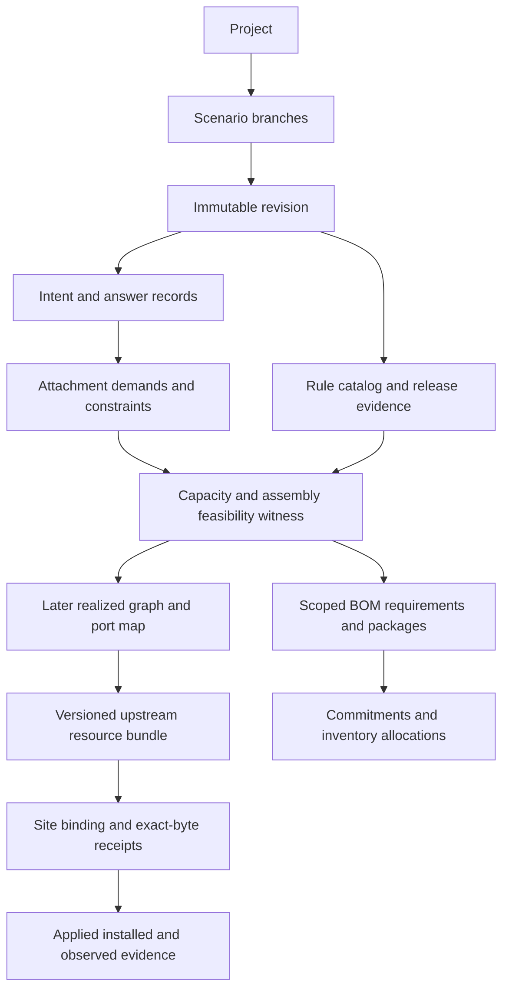

# D01: Domain model and progressive input contracts

Author: **t10 / model**. Assignment: [#8](https://github.com/afewell-hh/hh-aid/issues/8). Status: bounded design draft for independent review; no schema, database, solver, architecture, first slice or operational workflow approved. Independent reviewers, for lead to dispatch: **existing t3 / compat**, **t6 / topo**, **t5 / ux**. This author cannot approve the design.

## 1. Authority, evidence and scope

**Accepted sponsor direction (S):** initial users are Hedgehog SEs, possibly selected partners; BOM first, connection map second; new installation assets target the latest supported Hedgehog release while preserving exact evidence for each revision. First hardware scenario and first BOM readiness are undecided. See [product context](../product-context.md) at base `5c648506d0ff258f030da85741835e09dc25165b` and [lead's D01 dispatch](https://github.com/afewell-hh/hh-aid/issues/8#issuecomment-6715064790).

**Evidence labels:** R = source-research finding inherited from a pinned accepted report (not newly executed here); S = sponsor direction/scenario; P = proposed D01 contract; H = hypothesis to evaluate; Q = unresolved decision. Unless marked R or S, the contracts below are **P**. Arithmetic fixtures are synthetic conditional derivations, not hardware qualifications. No undocumented maintainer intent is asserted; R03's inferred preferences remain hypotheses.

| Input | Exact artifact revision | Acceptance/disposition and use |
| --- | --- | --- |
| R01 | [product-discovery.md at 75fe3edccafc756c6b92ad44dff9b71af73d3138][R01] | [lead acceptance](https://github.com/afewell-hh/hh-aid/issues/2#issuecomment-6713056374), [sponsor supersession](https://github.com/afewell-hh/hh-aid/issues/2#issuecomment-6715064410); sparse intent, provenance and comprehension risks |
| R02 | [hedgehog-support-contract.md at bf7437c3fc852cfe06663073edc36a08de75efbc][R02] | [lead acceptance](https://github.com/afewell-hh/hh-aid/issues/3#issuecomment-6712493946); C01–C21, K01–K09, update qualifications and associated resources |
| R03 | [upstream-reuse.md at 2b547901413c00fb8d7ce3eeff7d6669f2b78135][R03] | [lead acceptance](https://github.com/afewell-hh/hh-aid/issues/4#issuecomment-6713056575); §3.1 provenance and G1–G7 limits, no adapter choice adopted |
| R04 | [topology-scenarios.md at 49e6079a077d1d819d12485de3896a93e8371f74][R04] | [lead acceptance](https://github.com/afewell-hh/hh-aid/issues/5#issuecomment-6713220753); S01–S06, T01–T12, positive/negative witnesses |
| R05 | [hardware-and-bom.md at 8a8fccac6b6d560ef17889c4819dce3b8bf19a8c][R05] | [lead acceptance](https://github.com/afewell-hh/hh-aid/issues/6#issuecomment-6714714230); §2 catalogs, §4 assembly accounting, P01–P10, scoped quantities |
| R06 | [installation-lifecycle.md at 5a502b20fb5f6acdaa36512da78cb419d653470c][R06] | [lead acceptance](https://github.com/afewell-hh/hh-aid/issues/7#issuecomment-6714714409); §6 binding/receipt chain and §12 policy alternatives |

Issue dispositions supersede stale pending-review headers in these artifacts. Research acceptance does not approve their proposed workflows. R05's precise physical-profile/length qualifications supersede the broader R03 shorthand that profiles contain no physical information, and the unconditional scalar cable-length rule in R06.

Historical upstream evidence composition (R): release 26.05, Fabric v0.144.1 at `4bde50829fd7cfebac69332982abd1dee504a8a3`, Fabricator v0.51.4 at `d2316aca666eb278541276a11a5f8dae372bf629`, docs at `1be68948e177dcc031e91659ab5293ba19893ccf`; R02 records Broadcom SONiC v4.5.2 and gateway dataplane v0.38.2 as manifest evidence, not independently audited implementations. Optional NOS entries are not feature-equivalence evidence. **Current release is unresolved in this draft** pending [compat's release screen](https://github.com/afewell-hh/hh-aid/issues/3#issuecomment-6715064634). No new release or migration is invented.

## 2. Shared glossary and relationships

| Concept | Identity, relationships and boundary |
| --- | --- |
| Project / scenario / revision | Project owns alternatives; scenario has a parent revision and its own explicit changes; immutable revision captures intent, decisions, dependencies, evidence and generated artifacts. Branches share unchanged identities, not mutable answer state. |
| Fabric intent | Purpose (backend, frontend, storage, management, other), management boundary (`Hedgehog-managed`, external dependency, unresolved), service needs and policy. Mapping to upstream Fabric objects is explicit, versioned and potentially unresolved. |
| Upstream Fabric / domain | R: Fabric is controller topology ownership; its domain is a spine set with EVPN route boundaries. Neither is a Kubernetes namespace, rack, rail group or failure domain. A spine has one upstream domain; a leaf may have several. Shared leaves share failures. |
| Server / endpoint | Any non-switch Ethernet endpoint identity, including non-GPU and non-NVIDIA equipment. A device can have attachments to several fabrics. Upstream Server identity is mapped from the endpoint; it is not inferred from GPU count. Gateway and controller resources retain their upstream kinds when applicable. |
| Rack / tray / placement | Rack contains placed devices or trays; tray is a physical container with explicit host/device membership. Planning rack IDs are distinct from site rack/RU/orientation and inventory serials. Unknown hosts per tray stays unknown. |
| Accelerator / NIC / rail | Accelerator and NIC are components of endpoints/trays; a rail is an explicit association between accelerator identity and NIC/logical attachment roles. General endpoints need no accelerator or rail. Rail index is not a port number. |
| First-hop rail domain | Explicit endpoint group and per-rail first-hop leaf assignment. Many groups may use one common upstream spine domain. Membership changes are topology changes, not renames. |
| Plane | Requested network partition plus service/failure policy. Plane-to-upstream-domain/Fabric mapping is a decision with evidence. Multiple plane labels do not prove independence or connectivity. |
| Failure domain / redundancy requirement | Named shared-risk sets (NIC, cage, module, assembly, switch, route, rack, power, control plane) and required surviving paths/capacity under specified failures. Redundancy group in upstream is a separate mapping, not a physical guarantee. |
| Switch / profile revision | Planned switch identity with intended role, exact catalog revision, configured modes, upstream profile mapping and resource reservations. Device SKU, NOS and firmware qualification remain distinct from profile syntax. |
| Physical cage / logical port / lane | Cage is a physical host receptacle. Mode exposes logical ports using lane groups; logical lane identity is not necessarily one electrical lane. Store electrical/optical channel groups separately. Canonical port aliases, shared banks and pipeline budgets belong to the selected profile revision. |
| Attachment demand / logical link / Connection | Demand says what must connect, with rail/plane/service/speed/redundancy constraints. Realization assigns one link to two logical terminations; an upstream Connection groups one or more links by a supported family. External connections can omit a remote upstream object while retaining an external physical endpoint. |
| Assembly / component / end | Assembly is a physical purchasable or symbolic unit with constituent parts, connector ends and channel mapping. Detachable modules are distinct component instances; integrated cable end housings are not extra purchased optics. End IDs name physical connectors; groups within an end carry logical links. |
| Route / qualification tuple | Route carries segment/branch geometry, slack, plant, loss and evidence. Qualification ties both device modes, firmware, media/components, FEC/autoneg, role and release to a bounded compatibility verdict. Equal speed is insufficient. |
| Capacity reservation / growth / spare | Reservations consume planned resource capacity, including intentionally unused lanes. Growth is demand over a future phase. Spare stock is whole replacement units; unused tails or cages are not spare inventory. |
| BOM line / package / commitment | Line aggregates unique component requirements by exact unit or named class. Package declares included/excluded scope, dependencies, quantities and readiness. Commitment records ordered/delivered/installed supply, original revision and disposition without rewriting history. |
| Evidence / validation / approval | Evidence has source, version, scope and owner. Validation records a specific check over exact inputs. Approval records a named person's authority and disposition for an exact scope/hash; software records it, never supplies human approval. |



Cardinalities: a revision has many scoped results, each referencing one immutable input snapshot. A demand may remain unresolved or expand to multiple explicitly required attachments; every realized required attachment has exactly one link. Each link has two logical terminations and an ordered physical component path; one component/end can serve multiple links through distinct channel groups. A cage has one configured mode per revision, with zero or more occupied/reserved logical slots. One physical component may contribute to multiple BOM views but to only one counted order unit in a purchase aggregation. Cross-package supply allocations share a project ledger; packages cannot each spend the same stock.

Associated resources (R02): Fabric, VLANNamespace, referenced SwitchGroup and SwitchProfile, plus IPv4Namespace, VPC, attachments, peerings, External and Gateway families where required. Installation also depends on Fabricator/ControlNode/FabNode configuration. Kind existence does not make every kind mandatory. Store an explicit resource/dependency inventory with `generated`, `operator-provided`, `external`, `unresolved` ownership and validation coverage. Do not promise a complete deployment from Server/Switch/Connection alone. Upstream ServerProfile does not qualify endpoint hardware.

## 3. Progressive answers, provenance and invalidation

An **AnswerRecord** contains field ID, entity/scope ID, typed value or unresolved alternatives, units, origin, validity flags, source/actor, captured time, evidence reference, rule/default revision, dependency references, lock and supersession link. Distinguish absent/unknown from zero, empty set and explicitly not-applicable (the last needs a reason and applicability rule).

| State | Meaning and transition |
| --- | --- |
| Unknown | No usable value. A rule may produce an unresolved expression or offer a default, never silently fill a fact. |
| Assumed | Named conditional value selected from a versioned default or explicitly proposed assumption; record applicability and rationale. User confirmation creates a new user-origin record. |
| User | Explicit supplied value with actor/source; does not mean verified, supported or physically compatible. Retain the replaced assumption/derived value. |
| Derived | Value plus rule revision, exact dependency values, units and derivation/witness. Recompute when dependencies change. |
| Conflicting | Independent flag on any origin: contradictory assertions or violated hard constraints. Preserve alternatives and the conflict set; no last-writer-wins resolution. |
| Stale | Independent flag on any origin/result: changed dependency, expired applicability or evidence no longer sufficient for the target claim. Preserve original value and prior verdict. An answer can be both stale and conflicting. |

Compatibility is a separate axis: compatible-within-stated-scope, incompatible, unverified, disputed. Support and validation are also separate. A user can override a preference/default, not evidence of hardware compatibility. Setting a hard lock freezes the selected value/allocation or commitment; it does not suppress checks. Unlocking requires an explicit actor action, rationale and new revision. Catalog changes never overwrite a user value. For competing defaults, retain alternatives and request selection; rule precedence must be versioned and visible.

**ConflictRecord** carries ID, affected field/entity/result IDs, competing assertions and hard constraint IDs, input/evidence revisions, explanation or infeasibility witness, candidate relaxations and their impacts, and resolution actor/revision. Relaxations are suggestions, never applied automatically; do not call the conflict set or relaxation minimal without a demonstrated minimality check.

Questions have applicability predicates, dependencies, allowed units/ranges, default proposals, affected scopes and explanations of what an answer unlocks. H: prioritize questions that resolve high-impact quantity/feasibility uncertainty; D02 must evaluate this with users, not assert an optimal order. Cyclic derivations are rejected/reported as unresolved dependency cycles; mutual design constraints belong in a feasibility decision, not recursive answer defaults.

**Invalidation procedure:** record the changed input; compute transitive dependent results and shared-resource constraints (cage/bank, assembly, stock, failure set, domain/VPC, capacity reservation); mark affected current claims stale; regenerate a candidate; show before/after values, reasons and unresolved conflicts. Re-evaluate global consistency gates when producing a newly qualified result. At later wiring validation stages, validate the complete emitted snapshot, not isolated changed objects. Local caching is allowed only with exact dependency/coverage equality; it cannot establish a new target's support by omission.

Approvals remain historical records. Their applicability to a candidate becomes `retained within unchanged scope`, `needs review`, or `invalidated`, with reason and evidence. A previous approval is never silently copied onto a new package hash. An expired price invalidates a current-price claim, not necessarily physical quantities. Missing serials block only applicable binding/bring-up checks, not cable compatibility.

Scenario branching snapshots a base revision and explicit overrides. Three-way comparison uses stable IDs and base/left/right values; overlapping edits, deletions of locked entities and incompatible policy choices create conflicts. Unchanged facts can be shared immutably. Combining two scenarios does not combine their mutually exclusive BOM quantities.

## 4. BOM before exact wiring

The minimum useful BOM is a **conditional estimate**, not a claim of orderability. Each line carries scope, unit/class, quantity or expression, derivation, assumptions, feasibility evidence, missing facts, exclusions and applicable version. Unknown is never displayed as zero. Alternatives have separate totals; do not sum them or construct misleading minima from mutually incompatible choices.

Quantity precision is independent of qualification: `exact under stated assumptions`, `bounded` (with justified bounds), or `unresolved expression`. Thus an exact class count may still be a conditional estimate. Line and package scopes both have evidence/readiness; a package also checks shared dependencies and stock allocation, so it is not merely the minimum of its line badges. A conditional line may reference one stable aggregate demand ID such as “N links of class K in group G” without expanding all per-link IDs.

A quantity witness must preserve, as far as that claim requires:

- demand coverage by endpoint/rail/plane/group; required redundancy and failure policy;
- endpoint, uplink, service and growth resource budgets; configured cage modes including inactive lanes, canonical aliases, pipeline/bank/shared-speed limits;
- leaf-to-spine or mesh capacity and admissible connection/domain/service structure, including cut bounds under named failure states;
- assembly construction, branch pairing, shared physical failures and distinct counted components;
- selected SKU/role/NOS/firmware/physical qualifications and route bounds for any qualified or orderable claim.

A lower bound such as `ceil(total ports / ports per switch)` is labelled a **lower bound**, never a feasible quantity without an allocation witness. A symbolic witness may allocate demand classes to interchangeable resource groups without selecting exact printed port numbers. Deferring port assignment is allowed only where changing that assignment cannot invalidate the quantity/compatibility/geometry claim; otherwise retain the affected quantities as conditional. Different port rows can have different power, mode or pipeline restrictions. Arbitrary cage permutations are not assumed safe.

| Claim scope | Required evidence | What can remain deferred |
| --- | --- | --- |
| Conditional estimate | Explicit assumptions, expressions or conditional counts, constraint failures and excluded/unknown categories | Exact equipment, media, placement, detailed map, price, upstream export; no qualified/orderable label |
| Qualified quantity scope | Exact requirement units and qualification evidence; complete capacity/assembly witness for that scope, constraints and relevant dependencies resolved; target applicability established | Exact equivalent-port permutation, unaffected later packages, binding identities and prices; not a blanket service/performance guarantee |
| Procurement-candidate package | Qualified quantities plus exact orderable SKUs/revisions/lengths/branch geometry, packaging, plant dependencies, stock/commitment reconciliation and named approval needed | Unrelated excluded packages and site identities; readiness is blocked if excluded choices can invalidate included parts |
| Procurement-approved package | Authorized approver's recorded disposition on the package hash under an agreed purchasing policy | No inferred authority to execute an order; workflow policy remains Q |
| Connection-map realization | Complete scoped termination assignment, component/end map, upstream object/name map, associated-resource closure and check coverage | Site binding where permitted; no installation claim from snapshot validation alone |
| Installation/acceptance | Site routes/labels, relevant binding, exact-byte validation receipts, prerequisites, applied/installed/observed evidence and authority-specific acceptance | Only explicitly accepted deviations; no global readiness inferred from a partial package |

These are distinct predicates, not a compulsory ladder. BOM usefulness does not require a wiring export or U-gate. Whether an early exact package may be purchased before complete wiring validation is **Q**, not silently approved by this model. Relevant topology/service blockers cannot be hidden by calling a package physical-only.

Accounting follows R05 §4/6: installed requirement, growth-reserved capacity, spare requirement, reusable stock, outstanding orders, new requirement and pack-rounded order quantity are separate. Count distinct physical instances/order units; suppress kit children only in the purchasing view, preserve them for maintenance. An assembly spanning two planes is counted once and carries both planes' failure impact. Spares need an explicit policy, not an assumed percentage. Prices have currency/date/expiry/unit basis; unpriced quantities remain visible beside known subtotal.

Commitment events record quantities and allocations separately: `proposed`, `ordered`, `delivered`, `installed`; partial deliveries/installations can coexist within a line. Ordered-or-later quantities are locked. Cancellation, return, substitution and release of a lock are explicit disposition events, not backward state overwrites. “Parked” describes an assembly end, not a purchase state.

For an exact unit k, before outstanding commitments: `net_requirement = max(0, installed + approved_spares - exclusively_allocated_usable_stock)`. Then reconcile eligible outstanding orders allocated to that same requirement before proposing additional orders; do not subtract delivered stock and its historical order twice. Excess or incompatible committed parts remain a visible disposition problem, not a negative purchase count. Pack rounding and any resulting surplus are separate. Customer order references and real inventory never belong in this public repository.

## 5. Identity, regeneration, diff and migration

**Identity proposal:** allocate persistent opaque planning IDs when entities enter the project, with a retained registry. Display names, rack locations, role/group/rail/plane attributes, selected SKU and wiring names are mutable mappings. A pure tuple hash of those mutable attributes would churn identity on regrouping; R04/R06 tuple conventions are useful deterministic allocation keys, not sufficient entity identity. Store creation keys plus explicit continuity/split/merge decisions. Never reuse tombstoned IDs.

Count-only demands keep a persistent demand ID and stable occurrence keys when expanded; append occurrences rather than renumber surviving ones. A demand link ID identifies the required attachment role. A realized link ID records that role's actual pair of planning terminations; changing a server's printed LLDP port string through an approved binding map need not change the planning link. Changing its actual NIC or remote leaf is a realization change recorded in the diff; demand identity can survive. Split/merge of links or assembly construction gets new instance IDs with lineage. An unresolved physical class is a requirement ID, not a fabricated serial-numbered asset.

For BOM-to-map progression, every counted component requirement references its witness and stable demand IDs. Later component instances discharge those requirements through a reconciliation table: requirement ID → instances → link/end groups → quantity consumed. No duplicate discharge. A new map that needs more assemblies creates a BOM delta and commitment conflict before any ready claim. Wiring names are registry mappings checked against the selected upstream naming constraints; R02 K01 requires lowercase RFC1123 names, at most 62 characters and namespace default at the historical pin. Do not encode identity solely in labels or assume a live export preserves it.

**Regeneration contract:** inputs include scenario/base revision and identity registry, answer/lock records, exact rule/default/catalog/adapter revisions, upstream composition, policy/objective order and any explicit seed. Canonical serialization uses declared units, stable collection order and no volatile run metadata in generated content. Tie-breaks and selection policies must be versioned; equally valid alternatives cannot depend on wall clock, map iteration or completion order. Same complete inputs must produce identical semantic and content digests. Audit timestamps and raw validation runs are separate. This is a requirement for future verification, not an implemented determinism claim.

A semantic diff lists added/removed/retained identities, field and provenance changes, demand coverage, assignments, cage/mode changes, assembly/SKU/length counts, failure-set changes, stock/ordered impacts, price changes, target/evidence changes, check coverage and affected approvals. Reordering is not a topology change. Identical totals can hide a swapped rail, plane, or shared assembly and must still report those changes. Preserve old/new raw artifacts alongside semantic normalization version.

**Revision manifest:** model-format version; project/scenario/revision/parent IDs; exact input and identity-map digests; rule/default/constraint IDs and revisions; catalog item/profile/qualification revisions; upstream product composition and source SHAs; generator/emitter/checker versions; policy selections; per-artifact type, instance ID, path, digest and declared scope. Proposals do not select JSON or a database. Use non-circular digests: content manifest excludes approvals/receipts/signatures, which refer back to its digest; runtime timestamps are outside reproducible content. Byte digests and normalized semantic digests are distinct.

**Schema migration:** migrate a copy into a new revision with source/target format, migration tool revision, field/identity mapping, losses/unknown constructs and before/after checks. Preserve raw source and opaque unknown fields for audit without treating them as validated. No silent unit conversion, enum fallback, ID reassignment or dropping unknown locks. A lossy/ambiguous migration yields blocked dependent outputs and a reviewable diff. Reversibility is demonstrated by retained original bytes, not promised inverse transforms. Model-format migration and upstream release change are separate operations; neither confers live update legality.

## 6. Latest installation target, binding and lifecycle

An **EvidenceSnapshot** is immutable per revision. A **TargetObservation** is a separately recorded lookup of the supported product release/channel, observed time, source/manifests, component/NOS/profile composition, verification status and freshness policy. Latest individual component tags are not a compatible release bundle. Channel choice and refresh cadence remain Q. Failure to discover the target is `unknown-currentness`; retaining historical evidence is useful but cannot claim current installation readiness.

A target change creates an impact review over every affected rule, catalog tuple, fixture, artifact and commitment. Classify impact as `changed`, `unchanged with evidence`, or `unknown/uncovered`; keep readiness blocker/result as a separate axis (an item may be both changed and blocked); record why and the exact comparison scope. Regenerate into a candidate revision against a verified composition, re-run affected checks and global checks applicable to each requested output, then obtain required review. Only the new scoped evidence supports a currentness claim. Old revisions, receipts and approvals are immutable. No background automatic mutation or automatic acceptance is specified.

**ValidationRecord**: check ID/version and type (quantity, physical, schema, upstream semantic, support, service/failure, binding, live transition), target revision and input/config/catalog digests, tool/binary provenance, environment/command, coverage/exclusions, result (`pass`, `fail`, `blocked`, `not-run`, `not-applicable` with reason), raw result reference and capture time. Unstable upstream first-error order is retained raw; sorted presentation is not an exhaustive diagnostic set. R03 G1–G7 prevent equating a CLI pass with admission, update legality, hardware support or suitability. A check of a synthetic configuration never becomes a receipt for a real site configuration.

Intent is distinct from site binding: planning locations/port roles are intent; serial/MAC and host-advertised identity are binding to real equipment. Following R06's proposed chain, record unbound manifest → binding inputs → permitted-field transformation → bound manifest → imported bytes/config digest → operator receipt. Transformation includes exact old/new fields and tool/actor. Any physical connectivity, mode, SKU, rail or plane change goes through design revision, not identity binding. Binding of revision N is not evidence for N+1. Which server-port identity transformations are safe needs R06/domain confirmation; no live action is authorized here.

R06 policy alternatives remain open: operator-held config versus managed custody; wiring-only versus wider service generation; human-approved live operations versus file-only handoff; lightweight versus full deviation approval; site acceptance signatories. This model can represent each without selecting it. Adopt neither “all R06 gates before BOM” nor automatic inherited approval. Approved design, bound package, applied desired state, physical installed record, observed telemetry and accepted applied baseline remain separate records with coverage. Missing Fabric/Gateway kinds in a live export mean incomplete comparison, not equality. Snapshot revalidation of an existing fabric is not a migration procedure; R02/R06 immutable domain/ASN and old-or-new RoCE breakout restrictions still apply.

## 7. Worked walkthroughs

### W1 — sparse eight-rack request, then an answer and an override

Revision A0 records user intent `rack_count=8`, family label `NVL72`; exact generation/OEM, host identity, NIC modes, planes, growth and site are unknown. No Server count or exact SKU is invented. Next question proposal: identify tray/NIC variant and plane requirement, because they change attachment counts and cage/assembly construction.

Branch A1 explicitly assumes the R04 S06-1 fixture: 18 trays/rack, four rail relationships/tray, one 400G attachment/relationship, four rack-local leaves/rack, H400 capacities. Derived: 144 trays, 576 rail relationships/endpoint links, 32 leaves, 18 links/leaf, 9 occupied 2×400G endpoint cages/leaf (288 total), D=7.2 Tb/s/leaf and 230.4 Tb/s total. These are conditional quantities, not verified NVL72 specifications. Host count, spine policy, endpoint physical construction, management and other external dependencies are unresolved.

For an explicit **additional synthetic** uniform spine alternative, choose 16 active 800G uplinks/leaf and eight hypothetical spines with 64 usable ports each: two links per leaf–spine pair, 64 ports/spine, 512 uplinks total. Per-leaf U=12.8 Tb/s; D/U=0.5625. This witnesses slot arithmetic only, not nonblocking behavior, scale support, or equipment compatibility. R04's two-rack ten-uplink choice is not blindly multiplied into a common eight-rack fabric.

A2 newly answers `two planes`, requiring four dedicated rail leaves per plane per rack and switch-disjointness. Keep user lock `four total leaves/rack`. Conflict C-W1 cites all three rules: 2×4=8 leaves/rack required, exceeding four locked. Do not generate a “feasible” four-leaf design. A1 remains a historical single-plane estimate; affected A2 quantities are blocked, with alternatives: explicitly change leaf count, or allow rail sharing within each plane and review correlated failures (R04 S06-5). Neither establishes NIC/assembly independence.

User explicitly overrides the prior four-total policy in A3 to eight leaves/rack, preserving rack locality and recording why. Conditional new totals: 64 leaves and 1,152 endpoint links at 400G if the selected endpoint can supply two attachments per rail. Preserve rack/tray/rail IDs; add plane attachment demands and new leaf instances through lineage. Exact NIC split mode and assembly compatibility remain unverified. The override resolves the policy conflict; it does not resolve hardware qualification. Any prior committed four-leaf-per-rack purchase remains a supply record, with additional requirement and qualification impact shown.

### W2 — sparse 512-node request and limits of aggregate sizing

B0 records `node_count=512`, label `B300 HGX`. Do not infer exact NIC count, planes or OEM. B1 explicitly selects conditional R04 S05-A: eight rails, two 400G attachments per rail, two switch-disjoint planes, groups of 64 nodes, one leaf/rail/group/plane, H400. Counts: 8,192 endpoint links; eight first-hop groups/plane; 64 leaves/plane (128 total); 4,096 active 800G uplinks with 32 per leaf. Given 64 usable spine ports, uniform full connectivity is witnessed by 32 spines/plane (64 total) and one link per leaf–spine pair. D=U=25.6 Tb/s/leaf normally; one spine loss leaves 24.8 Tb/s, so D/U=32/31 and a full-injection-after-one-spine-loss requirement fails.

Endpoint switch cages: 128×32=4,096 occupied 2×400G cages. This is **not** 4,096 proven cables. R05's integrated split, separate-optics or shuffle constructions can have different counts/shared failures and need actual endpoint geometry. Output lists leaf/spine classes and endpoint/uplink demand with derivations, while cable/optic totals remain construction-dependent. No zero cable line, no price invented, no precise hardware qualification.

If B2 requests one VPC spanning both domains on A-only/B-only leaves of the same Fabric, R04 N13 exposes a service conflict: each attachment leaf lacks a required VPC domain. Two per-plane VPCs cannot peer when their domain sets are disjoint. No fabric cross-plane path is implied; a host service solution or separate-Fabric design needs distinct evidence. The quantity witness cannot hide this suitability blocker. B300-B's eight 800G links has the same aggregate bandwidth but does not attach every rail to both planes; the semantic diff must expose this if compared as an alternative.

### W3 — exact conditional assembly accounting, refinement and later map

Synthetic small fixture, not hardware: two 400G endpoint demands d1/d2, one switch cage c1 configured 2×400G, two native 400G endpoint cages e1/e2, and one integrated two-tail assembly h1 with qualified geometry **assumed only for arithmetic**. h1 has physical ends P/A/B; P carries lane groups 1/2. It realizes two links using three cages, one assembly, zero detachable modules. Park d2: h1 still counts once; its B end and corresponding slot remain reserved, not spare stock. Negative case: assign a second independent integrated parent to c1, or both tails to group 1; reject despite correct aggregate rates.

Alternative construction for two active links: one twin-port parent module, two child modules and two fibers = three modules plus two fibers, not four modules. Shared parent failure affects both. These are separate BOM alternatives, not additions to h1.

Refinement event: an exact SKU tuple, firmware/mode evidence, route/branch bounds and approver references are supplied. Recheck quantity/physical constraints; only if they pass can this scope become qualified. This walkthrough supplies **no actual SKU or qualification receipt**, so its displayed state remains conditional. An optics-only procurement package may exclude fibers only if plant/connector/PMD/polarity assumptions are fixed and qualified; if plant is unknown, it stays blocked. The full project can remain provisional while an independently qualified package is reviewed, subject to the purchasing policy decision.

Detailed map later discharges the existing d1/d2/h1 requirement IDs into concrete API ports and end/group paths; it must reproduce quantities and reservations or report a delta. A reordered display/name does not change those requirements. Moving e2 beyond the assembly branch reach invalidates h1's qualification even if link counts stay two. Binding serials later does not alter the conditional arithmetic.

### W4 — synthetic release change with commitments and coverage

This is a **contract test**, not a factual claim of a release after 26.05. Let evidence E0 qualify a hypothetical package of four whole harnesses under target T0; two delivered units and two outstanding ordered units are allocated to it. Record real qualification/approval only in a real project with evidence; here all names and verdicts are illustrative.

Target observation T1 arrives with a verified composition in the hypothetical test. Its screen says: a relevant cage-mode budget changed; a distinct standalone native-link tuple is unchanged by cited comparison; a harness firmware compatibility row has no T1 evidence. Candidate revision N+1 retains all planning IDs, locks and orders. Mode-dependent witness is stale and recomputed; the native link retains historical evidence with an explicit T1 applicability review, not automatic certification; the harness scope is unknown/blocked until evidence arrives. Required new upstream/global checks are `not-run` until receipts exist. “No quantity delta” alone is not a pass.

Suppose recomputation requires six compatible harnesses: prior required four → six; two delivered plus two outstanding eligible units cover four, leaving two additional units before pack rounding. If T1 compatibility of those four is unknown, show the conditional two-unit shortfall **and** the qualification blocker; do not claim an executable purchase plan. If later incompatible, retain them as committed units needing disposition and recompute eligible supply rather than deleting/substituting them. A price-only change is a separate cost diff. The prior four-unit package approval remains attached to N; any new package needs the applicable approval. Unchanged standalone packages may proceed only with scoped current evidence and authority. Prior bindings are not copied; new bindings/receipts refer to N+1. For already installed hardware, this is impact analysis, not authorization or proof of an in-place change.

## 8. Contract traceability, verification and open decisions

| Contract ID | Source/applicability; hard or soft; units | Verification/example and counterexample | Owner/reviewer |
| --- | --- | --- | --- |
| DM-01 Identity continuity | P §5; hard for regeneration; IDs | Rename/reorder retains IDs; regrouping cannot silently replace all identities | model / ux, topo |
| DM-02 Answer truth | S provisional principle, R05 §2; hard; typed units | W1 override retains provenance; user value cannot change unverified to qualified | model / ux, compat |
| DM-03 Scoped quantities | S BOM-first; R04 T01–T12; hard for quantity claim; ports/Gb/s/components | W1/W2 witness vs a bare port-total lower bound; failures reported | model / topo |
| DM-04 Physical counting | R05 P01–P09; hard; instances/lanes/metres | W3 shared parent counted once; duplicate lane or kit child purchase rejected | model / topo; parts evidence |
| DM-05 Version/currentness | S latest direction, R02/R03; hard for current claim; versions/digests | W4 unknown impact blocks affected claim; old pass cannot certify T1 | model / compat |
| DM-06 Scoped evidence | R03 G1–G7, R06 §6; hard; artifact/check coverage | Synthetic receipt stays synthetic; missing resource kinds cannot imply equality | model / compat |
| DM-07 Commitments | S preserve overrides/orders, R05 §6; hard; whole units | W4 supply counted once; outstanding order not reordered or treated as delivered | model / topo, ux |
| DM-08 Question priority | H §3; soft; impact/user effort | W1 variant/plane answers change quantities; no fixed universal wizard order | model / ux |

### Reproducible document checks

Read the six exact artifacts with `git show <revision>:docs/research/<file>.md`; use the acceptance comments in §1 rather than their older headers. D01's arithmetic can be reproduced with Python 3 (standard library only):

```python
from fractions import Fraction
assert (8*18, 8*18*4, 8*4) == (144, 576, 32)
assert 32*9 == 288 and Fraction(18*400, 16*800) == Fraction(9,16)
assert 32*16 == 8*64 == 512 and 32*2 == 64  # eight-spine witness
assert 2*4 > 4 and 8*8 == 64 and 8*18*4*2 == 1152
assert 512*8*2 == 8192 and 2*(512//64)*8 == 128
assert 128*32 == 4096 and 2*32 == 64
assert 64*32 == 32*64  # per-plane leaf/spine port conservation
assert Fraction(64*400, 31*800) == Fraction(32,31)
ends = {'d1': ('P.1','A.1'), 'd2': ('P.2','B.1')}
assert len({e for pair in ends.values() for e in pair}) == 4
assert len({'h1' for demand in ends}) == 1
assert max(0, 6-2-2) == 2  # delivered and outstanding are disjoint
print('D01 conditional arithmetic checks passed')
```

These checks cover arithmetic and symbolic identity accounting only. They do not execute a model, schema migration, determinism, solver, upstream validator/admission, VLAB, hardware or performance test. Future D03/D04 verification must independently derive expectations for alias/pipeline conflicts, split/merge identity, unchanged-total rail swaps, conflicting locks, cross-branch merges, lossful migrations, stale target evidence, double-allocated stock and BOM/map reconciliation. No interview or human approval is fabricated.

Documentation verification for this draft: the embedded Python arithmetic ran successfully; six full-SHA research artifact paths resolved through `git cat-file -e`; Markdown reference definitions, local links and code fences were checked. No network availability claim is made for every link. Whitespace is checked on the staged artifact before commit.

### Decisions and limitations

| ID | Open choice and alternatives | Owner; safe interim handling |
| --- | --- | --- |
| D-M1 | First output: conditional estimate, qualified quantity scope, or procurement package; first hardware tuple | Sponsor/lead with parts; no first scenario selected here |
| D-M2 | Purchasing before full wiring validation: scoped feasibility review or require full snapshot gate for purchasing | Sponsor/lead with topo/ops; estimates remain useful, purchasing policy unresolved |
| D-M3 | Isolation, partial-group packing, growth and spares policies | Sponsor/site requirement owner; explicit alternatives, no silent defaults |
| D-M4 | Current-target channel, discovery authority and freshness cadence | lead/compat; currentness unknown until accepted screen and policy |
| D-M5 | Custody, service-object ownership, binding workflow, deviations and acceptance authority | Sponsor/ops/D05; R06 D-OPS-1–7 remain proposals |
| D-M6 | Persistent IDs plus lineage versus pure tuple-derived identity; readiness terminology | lead with ux/topo/compat; this draft recommends persistent IDs and scoped predicates, pending reconciliation |

Confidence is high that the distinctions are needed by accepted research; usability, implementation cost, scale and concrete qualification remain untested. A symbolic witness can be expensive or incomplete for real constraints; a solver cannot claim feasible when it merely fails to find a contradiction. Report `unknown/not proven` separately from `infeasible` (with a demonstrated conflict). No schema representability or raw bandwidth arithmetic establishes deployability.

### Acceptance and handoff

| #8 criterion | Evidence | Disposition |
| --- | --- | --- |
| Glossary and entity relationships | §2, diagram and cardinalities | Draft delivered |
| States/provenance/defaults/locks/branches/dependencies | §3, W1/W3 | Draft delivered |
| Identity/determinism/diff/migration/versions/latest/BOM progression | §4–6, W4 | Draft delivered; implementations untested |
| Sparse requests/new answer/conflict/override/readiness/release change | W1–W4 with explicit assumptions and blockers | Draft delivered; no hardware certificate |
| Evidence distinctions, versions, reproducibility | §1, traceability and checks | Documentation evidence only |
| Independent disposition and required decisions | Existing t3 / compat, t6 / topo, t5 / ux named; D-M1–6 above | **Pending; author does not approve or close #8** |

Handoff to lead: dispatch the three existing reviewers on their assigned dimensions and reconcile D02 vocabulary before acceptance. Ask compat to assess target/evidence/resource boundaries, topo to assess quantity witnesses and BOM/map reconciliation, ux to assess answer state/identity/conflict explanations. Next downstream work is D03/D04 contract use only after lead's dependency acceptance, and D05 integration review under its own assignment. No new sessions, production implementation or ADR decision requested by this draft.

[R01]: https://github.com/afewell-hh/hh-aid/blob/75fe3edccafc756c6b92ad44dff9b71af73d3138/docs/research/product-discovery.md
[R02]: https://github.com/afewell-hh/hh-aid/blob/bf7437c3fc852cfe06663073edc36a08de75efbc/docs/research/hedgehog-support-contract.md
[R03]: https://github.com/afewell-hh/hh-aid/blob/2b547901413c00fb8d7ce3eeff7d6669f2b78135/docs/research/upstream-reuse.md
[R04]: https://github.com/afewell-hh/hh-aid/blob/49e6079a077d1d819d12485de3896a93e8371f74/docs/research/topology-scenarios.md
[R05]: https://github.com/afewell-hh/hh-aid/blob/8a8fccac6b6d560ef17889c4819dce3b8bf19a8c/docs/research/hardware-and-bom.md
[R06]: https://github.com/afewell-hh/hh-aid/blob/5a502b20fb5f6acdaa36512da78cb419d653470c/docs/research/installation-lifecycle.md
