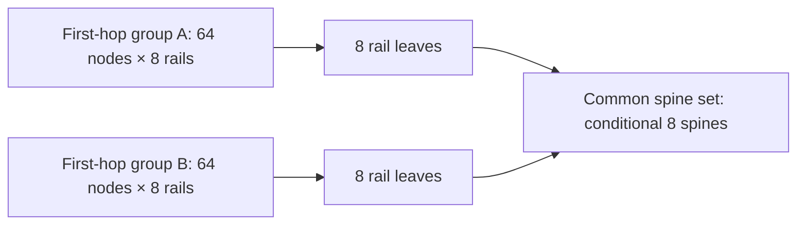

# R04: topology scenarios, rail domains and allocation constraints

Author: t6 / topo. Date: 2026-11-07. Assignment: [#5](https://github.com/afewell-hh/hh-aid/issues/5).
Status: bounded research handoff; not an approved design, hardware catalog or deployment certificate.
Independent reviewer: existing t3 / compat, assigned by [lead](https://github.com/afewell-hh/hh-aid/issues/5#issuecomment-6712494347). Review pending. Physical/performance verification remains separately gated; no additional reviewer session is assumed to exist.

## Evidence and scope

Working contract: [R02 at bf7437c](https://github.com/afewell-hh/hh-aid/blob/bf7437c3fc852cfe06663073edc36a08de75efbc/docs/research/hedgehog-support-contract.md), independently reviewed in [topo's disposition](https://github.com/afewell-hh/hh-aid/issues/3#issuecomment-6712425594). That research acceptance does not approve a product support window. Inputs from [product context](../product-context.md) are sponsor scenarios, not equipment specifications.

| Source | Pin / evidence boundary |
| --- | --- |
| Fabric | v0.144.1, `4bde50829fd7cfebac69332982abd1dee504a8a3`; API, validator, profile and planner source |
| Fabricator | v0.51.4, `d2316aca666eb278541276a11a5f8dae372bf629`; GPU rail generator precedent |
| Hedgehog docs | `1be68948e177dcc031e91659ab5293ba19893ccf`; independently pinned snapshot matching release 26.05 |
| NVIDIA HGX AI Factory, Components | [Vendor page](https://docs.nvidia.com/enterprise-reference-architectures/hgx-ai-factory/latest/components.html), accessed 2026-11-07; mutable latest page, not a pinned OEM bill of materials |
| NVIDIA DGX GB rack guide, Hardware | [Vendor page](https://docs.nvidia.com/dgx/dgxgb200-user-guide/hardware.html), accessed 2026-11-07; mutable vendor reference, not universal NVL72 configuration |

The HGX vendor page describes eight ConnectX-8 adapters and 800 Gb/s per GPU as 2×400 Gb/s Ethernet. This supports investigating split-port planes, not assuming two 800G Ethernet links per GPU. The DGX rack guide describes 18 compute trays with four GPUs each; its cluster NIC entries distinguish GB200 400G from GB300 800G. It does not establish Hedgehog support, the sponsor's four Ethernet leaves per rack, or a universal shuffle map. Exact NIC variants, exposed ports, firmware, optics and OEM wiring remain R05 inputs. NVLink switches/backplanes are not Ethernet fabric switches or Ethernet cable assemblies.

Evidence labels used below: **given** = explicit scenario input; **derived** = arithmetic/graph implication; **source** = cited upstream behavior; **unknown** = missing qualification. No inferred maintainer intent is used. Hypothetical profiles H400/H800/H200 below are calculation fixtures, not purchasable or supported SKUs. All scenarios remain provisional for installation export.

## Graph vocabulary and accounting

A node denotes an endpoint system, not a GPU. A tray is a physical container; the number of Server objects follows actual host/endpoint identity and is not inferred from GPU count. A rail identifies a GPU/NIC relationship supplied by the profile. A first-hop rail domain is a group of endpoints whose same rail terminates on the designated leaf. An upstream Fabric domain is a spine set with EVPN boundaries. A plane is a requested network partition with an explicit isolation/failure policy; it is not established by a label. Fabric, Kubernetes namespace, VPC, redundancy group, rack and power failure domain remain separate attributes.

Use a multigraph: each edge is one logical Ethernet link with endpoint IDs, speed per direction, medium, rail, plane, parent cage/lane and physical assembly reference. Parallel leaf-spine edges consume separate ports. A Connection object can contain multiple edges; its count is not a link count. Endpoint port IDs are unique within their device. A GPU rail must not be silently turned into LACP.

All rates below are decimal Gb/s or Tb/s **per direction**; 1 Tb/s = 1,000 Gb/s. Do not double a full-duplex rate or confuse it with GB/s. For a leaf, let D be the sum of active endpoint line rates and U the sum of active usable uplink line rates. Raw oversubscription is D/U; if U=0 and remote traffic is required, it is infeasible. For local-only traffic, D/U is not a service verdict. Reserved/inactive uplinks do not contribute U. A policy such as D/U ≤ 1 is an explicit requirement, not a universal optimum.

For every relevant graph cut and failure state, demanded traffic across the cut must not exceed usable cut capacity. That necessary bound still does not prove nonblocking operation: traffic matrix, routes, ECMP hashing, per-flow limitations, host injection, protocol overhead, lossless behavior and convergence matter. No scenario below proves nonblocking performance.

## S01–S03: eight-rail 400G endpoint scenarios

### Shared inputs and allocation witness

Given H400: a hypothetical leaf with 64×800G cages, cages 1–32 configured 2×400G for endpoints, cages 33–64 configured 1×800G for uplinks. There are 64 endpoint lane positions and 32 uplinks, not 96 physical cages. Exact profile/pipeline/media feasibility is unknown. All nodes have rails r=0…7, one independent 400G link each; no redundant second link is implied for a rail.

For node n, choose domain d=floor(n/64), local index j=n mod 64. S01 (32 nodes) uses leaves L[0,k], k=0…3; map rail r to k=r mod 4 and endpoint slot q=j+32 floor(r/4). S02 (64 nodes) and S03 (128 nodes) use L[d,r] and q=j. Slot q maps to cage 1+floor(q/2), lane 1+(q mod 2). Thus the S01 paired rails are (0,4), (1,5), (2,6), (3,7). This is a chosen deterministic witness, not a mandatory rail ordering.

| Scenario | Nodes / first-hop groups | Endpoint edges | Leaves | Endpoint cages total | Active 800G uplinks | D per leaf / U per leaf | Aggregate D |
| --- | --- | ---: | ---: | ---: | ---: | --- | --- |
| S01 | 32 / one group | 256 | 4 | 128 | 128 | 25.6 / 25.6 Tb/s | 102.4 Tb/s |
| S02 | 64 / one group | 512 | 8 | 256 | 256 | 25.6 / 25.6 Tb/s | 204.8 Tb/s |
| S03 | 128 / two groups of 64 | 1,024 | 16 | 512 | 512 | 25.6 / 25.6 Tb/s | 409.6 Tb/s |

Equations: endpoint edges=8N; endpoint leaf count=8N/64 for these full cases; D=64×400G; U=32×800G. Endpoint cage totals count both lanes used, but do not count cable assemblies. Every leaf has 96 logical data ports in this witness.

Additional conditional spine assumptions: each spine has **64 usable 800G leaf-facing ports**, no reserved ports, all leaf uplinks active, uniform full leaf-to-spine connectivity, one shared spine layer. Let L be leaf count and S spine count. Capacity requires 64S ≥ 32L. Choose S=L/2, giving S=2/4/8 and m=32/S=16/8/4 links per leaf-spine pair. Number leaves globally l=0…L−1. For spine s=0…S−1 and parallel link t=0…m−1, connect leaf cage 33+s*m+t to spine port 1+l*m+t. Every leaf uses exactly 32 uplinks and each spine exactly L*m=64 ports; port ownership is unique. This explicit witness resolves the arithmetic under the stated assumptions, not a real SKU selection or nonblocking proof.



The S03 groups need not be two upstream domains: they share a spine set in this witness. Assigning different upstream domains without a service design changes route boundaries. Source mapping: R02 C01/C06/C12/C16; ordinary unbundled endpoint and fabric links, not a rail API. [GPURail.Build][B-rail] offers a bounded eight-rail/four-leaf example; its fixed two-spine demo cannot be copied to certify the larger counts.

### Failure and feasibility status

S01 leaf loss removes two complete rails from every node. S02 leaf loss removes one complete rail from all 64 nodes. S03 leaf loss removes one rail from one 64-node group. Other rails do not automatically substitute for the missing GPU/NIC path; workload/host behavior is unknown. Single spine loss reduces each leaf's U to 12.8 / 19.2 / 22.4 Tb/s in S01/S02/S03. Raw D/U becomes 2 / 4⁄3 / 8⁄7; a requirement to retain full remote injection bandwidth after one spine failure fails these witnesses.

| Layer | S01–S03 disposition |
| --- | --- |
| Logical feasibility | Explicit unique-port witnesses and full endpoint coverage under H400 assumptions |
| Source support | Conditional unbundled/two-layer fabric families; rails remain planning semantics |
| Exact-profile feasibility | Unknown; candidate DS5000 profile includes 2×400G but is not a full scenario qualification |
| Physical connectivity | Unknown exact NIC/optic/reach/FEC/assembly mapping; R05 |
| Service/performance | VPC attachment, addressing, RoCE, routing, traffic matrix and performance unproved |
| Failure behavior | Removed-edge capacity derived above; convergence and workload survival unproved |

## S04: frontend, storage and management

Given 32 nodes, each with two 200G frontend links: 64 endpoint edges, 12.8 Tb/s total. H200 has 64×200G ports; reserve ports 1–32 for endpoints and 33–64 for inter-switch links. Node n connects its distinct ports a/b to leaf A/B port n+1. Each leaf has D=6.4 Tb/s. Host LACP/ESLAG versus independent routed attachment is an explicit service choice; the host mode cannot be inferred from link count.

| Alternative | Concrete logical witness | Capacity / failure implications | Source boundary |
| --- | --- | --- | --- |
| S04-M, two-leaf mesh | Pair A port 33+t with B port 33+t, t=0…31: 32 mesh edges, 64 leaf inter-switch terminations | Cross-leaf cut 6.4 Tb/s each direction. Leaf loss removes one endpoint link per node; link loss reduces cut by 0.2 Tb/s. No independent transit switch. | R02 C07; same single domain, exact profiles and service mode conditional |
| S04-C, two leaves/two spines | Each leaf ports 33–48 to spine 0 and 49–64 to spine 1. Each spine allocates 16 distinct ports to A and 16 to B. 64 fabric edges. | Each leaf U=6.4 Tb/s. One spine loss leaves 3.2 Tb/s per leaf, raw D/U=2. Uses two additional switches; no assertion of universally better availability. | R02 C06; exact profiles, role/port checks and service mode conditional |

ESLAG's documented 2–4-switch contract is an option only with compatible profiles, redundancy groups/domain sets and host LACP. The one-switch/two-link and one-link exceptions remain R02 Q2; do not use them as supported redundancy. DS5000 has ESLAG disabled and cannot be substituted just because capacity fits. Mesh links are not MCLAG peer/session links. A singleton endpoint is also valid planning intent: one unbundled link with explicit loss of connectivity on its leaf failure, not a redundant design.

Separate storage with the sponsor's same 2×200G endpoint pattern adds 64 links and another independent capacity calculation. Combining frontend/storage consumes shared ports and failure capacity; it cannot reuse the same physical links twice without an explicit service-sharing design. Additional storage appliances and gateways need their own endpoints and reservations.

Sponsor management assumptions give 32×2=64 in-band 10GBASE-T links (640 Gb/s aggregate), without proving copper-capable profiles or redundancy semantics. BMC count is 32×(1+b), where b is the number of separately managed BF3 devices per node: b=1 gives 64, b=2 gives 96 endpoint BMC links, assuming each is one 1G link. These exclude switch/controller/gateway/other rack management. OOB boot/control topology and ownership are R06 unknowns. Keep it an external dependency until independently verified as Hedgehog-managed; no management Connection variant exists. Non-GPU and non-NVIDIA endpoints use the same accounting rules.

S04 layer status: logical witnesses provided; source families conditional; exact profiles and physical connectivity unknown; VPC/service/performance unproved; failure capacity derived only. Neither alternative is installation-ready.

## S05: B300 two-plane alternatives

The vendor reference motivates **B300-A**: assume eight rails per node, each with two independently exposed 400G Ethernet ports, one on plane A and one on plane B. This is 16 logical endpoint links, 6.4 Tb/s per node, not 16×800G. Each plane gets a separate copy of H400's rail witness. For 32/64/128 nodes, totals are 8/16/32 leaves and conditional 4/8/16 spines across both planes; each plane independently satisfies the assumptions behind S01–S03. For 512 nodes partitioned into eight 64-node groups per plane: 8,192 endpoint edges, 128 leaves and 4,096 800G uplinks total. Under the same extra 64-port spine assumptions, 32 spines per plane (64 total), one link per leaf-spine pair, is a logical witness. These are scale arithmetic, not validated scale limits.

**B300-B** is a deliberately different hypothetical input: eight 800G links per node, four whole rails assigned to each plane. H800 uses 32 endpoint cages at 1×800G and 32 uplink cages at 1×800G, so each leaf collects one rail for at most 32 nodes. At 32 nodes each plane needs four rail leaves; at 64 nodes, two first-hop groups need eight per plane. Although aggregate per-node bandwidth equals B300-A, no rail has an attachment in both planes. B300-B does not meet a requirement that each GPU retain a network path in the other plane. The cited HGX page does not establish this port mode for the requested OEM system: treat it as an alternative input to validate, not an asserted B300 feature.

**B300-C** keeps B300-A's links but permits shared leaves in both upstream domains. That is a documented multi-domain use [D-domains], but a single shared leaf/power failure can remove both plane attachments. Reject it if hard policy demands physically disjoint planes; allow it as a separate comparison if policy requires only EVPN boundaries and accepts shared hardware. Do not silently weaken isolation to save switches.

For B300-A, map planes to disjoint leaf/spine sets and distinct upstream domains only after VPC/NIC service requirements fit; separate Fabric objects are another conditional option with external interconnection. A node/NIC, rack, power system or control plane may still be shared. Spell out which failure sets must be disjoint. Domain additions to an existing populated Fabric are restricted; predeclaration is distinct from migration [F-update]. No universal rebuild rule follows.

S05 layer status: A/B have conditional logical witnesses; C has representable shared-leaf structure. Source supports bounded multi-domain use, not arbitrary plane guarantees. Exact NIC modes, switch profiles, physical breakout and reach remain unknown. Per-plane bandwidth balance is derived; service steering, half-bandwidth recovery, fault convergence and performance are unproved. Plane loss in A removes half the nominal endpoint bandwidth; survival is not guaranteed by remaining links alone. No hardware quantities should be promoted to procurement without R05/R06 evidence.

## S06: NVL72 rack, two-rack and shuffle variants

Maintain rack R, tray t=0…17 and rail r=0…3 identities. Given four GPUs and four NIC relationships per tray gives 72 GPU/rail relationships per rack; it does not imply 72 Server objects. Endpoint-host identity remains a catalog input. Sponsor policy fixes **four Ethernet leaves per rack** despite spare ports. Their separation from NVLink and management switches is explicit.

| Variant | Exact calculation assumptions and witness | Boundary |
| --- | --- | --- |
| S06-1, one rack / single plane | Assume one 400G edge per rail relationship; connect (R,t,r) to rack-local leaf (R,r), slot t. 72 edges, 18 per leaf, 7.2 Tb/s D per leaf. Pair slots in 2×400G cages: 9 used endpoint cages/leaf. | H400 leaves intentionally underfilled; 23 of the 32 endpoint cages can remain growth-reserved. Four-leaf placement overrides pure port minimization. |
| S06-2, two racks / common spines | Duplicate S06-1 with leaves remaining rack-local: 144 edges and eight leaves. For an illustrative no-growth bandwidth-balanced allocation, activate ten 800G uplinks per leaf, five to each of two hypothetical 64-port spines: 40 ports/spine, U=8 Tb/s/leaf. | This uses only ten uplinks, unlike S01–S03. One spine loss gives U=4 Tb/s and D/U=1.8. A growth reservation may instead require all 32 uplinks, changing spine count. |
| S06-3, two racks / mesh pairs | Pair same-rail leaves across racks with ten parallel 800G mesh links each: four disconnected rail components before service policy, 40 mesh edges. Same single upstream domain per pair. | 8 Tb/s cross-rack capacity per rail pair, no automatic cross-rail reachability. Not a replacement for a connected common-spine fabric if that is required. Exact support of the selected graph/hardware remains conditional. |
| S06-4, two planes / eight leaves per rack | Assume each rail exposes 2×400G; put one edge in each plane, with four dedicated leaves per plane per rack. 144 endpoint edges/rack, 18 per leaf. | Requires explicit change from the four-total-leaf policy and a verified dual-port profile. Not automatically true for GB200 or every GB300 tray. |
| S06-5, two planes / four total leaves | If each rail must reach both planes, two leaves/plane may each collect two rails: 36×400G endpoints and D=14.4 Tb/s/leaf, under 64-slot H400 capacity. | Conditional dual-port input; relaxes one-leaf-per-rail policy and correlates two rails per leaf failure. All three policies cannot be silently conflated. |

For an 800G single-link tray variant, substitute H800 endpoint slots: S06-1 uses 18 native cages per leaf and D=14.4 Tb/s, not nine breakout cages or 7.2 Tb/s. Keeping S06-2's ten uplinks then produces D/U=1.8; the planner must recompute. Vendor tray generation is therefore mandatory input.

Eight racks with S06-1 assumptions give 144 trays, 576 GPUs/rail relationships, 576 Ethernet endpoint edges, 32 rack-local leaves and 230.4 Tb/s aggregate D. This is an explicitly conditional estimate; “eight NVL72 racks” alone cannot select GB200/GB300, port mode, plane count, spine allocation or final BOM.

A shuffle is a physical lane permutation, not a bandwidth multiplier or new topology family. Represent an assembly ID and an explicit mapping from each source (device, cage, lane) to destination (device, cage, lane), with speed/media/reach and polarity qualifications. Proposed positive symbolic fixture: two source NIC ports a/b map bijectively to destination lanes 1/2 of one configured 2×400G cage. Its two logical links may belong to one multi-ended assembly; assembly count is one only if that actual physical product is verified. Negative fixture: a and b both mapped to lane 1, or plane-A source mapped to plane-B destination. Reject even though total endpoint counts match. Pairing within a rack versus crossing racks changes reach, serviceability and shared assembly failure; no universal NVIDIA shuffle SKU or pinout is asserted.

S06 layer status: logical cases derive under their individual assumptions; unbundled/fabric/mesh support maps to R02 conditional families. Exact four-leaf SKU, tray port modes and shuffle compatibility are unknown; R05 required. Services, rail-to-rail demand, cross-rack performance and convergence are unproved. Rack loss removes its local trays and leaves; same-rack placement is not rack-loss protection. Shared assemblies may correlate endpoint/plane failures even with separate switches.

## Constraint register

All constraints apply to the stated scenario and preserve user overrides. Conflicting hard rules produce an explanation, never a silent relaxation. Optimization preferences apply only after feasibility. Sources are the pinned contract above, explicit sponsor inputs, or a labeled proposed planning policy; owner names denote responsibilities, not new sessions.

| ID | Hard / soft, units, applicability | Rule, source and validation strategy | Positive / counterexample | Owner |
| --- | --- | --- | --- | --- |
| T01 | Hard; endpoints, all | Cover every required endpoint exactly once per specified attachment; compare required IDs with allocated multiset. Sponsor + proposed policy. | 256 distinct S01 edges / duplicate one rail and omit another |
| T02 | Hard; cages/lanes, all | One allocation per effective logical port; track parent mode and aliases, including base/lane-1 alias [F-conn]. | lanes 1 and 2 / base plus lane 1 |
| T03 | Hard; rail/domain IDs | Preserve explicit rail membership and first-hop grouping. Source: sponsor S01–S03; compare tuples. | S03 group-local leaves / combine two groups without consent |
| T04 | Hard when requested; failure sets | Disjoint required plane/redundancy failure sets, including switches, rack/power and assembly. Proposed policy; remove each named failure set and evaluate required paths. | disjoint switches / shared leaf with strict switch isolation |
| T05 | Hard; links, Gb/s | Profile-supported mode and end-to-end speed/media/FEC; upstream profile checks plus R05 physical evidence. | compatible verified ends / 800G edge to 400G-only endpoint |
| T06 | Hard policy; D/U dimensionless | Count active usable links only and enforce chosen normal/failure-state bound. Derived cut arithmetic. | S02 normal ratio 1 / S02 spine-loss ratio 4/3 under bound 1 |
| T07 | Hard; usable ports | Respect endpoint/uplink/service/growth reservations without double use. Proposed accounting policy. | 64 used of 64 / 65 required on 64-port spine |
| T08 | Hard if locked; rack IDs/leaf count | Honor per-rack placement and intentional underfill. Sponsor NVL72; verify rack assignment. | four leaves/rack / consolidate eight racks into remote leaves |
| T09 | Hard; membership/ASN | Same-Fabric/domain and service attachment checks; retain R02 K05/K06/K08 [F-conn], [D-domains]. | mesh in one domain / cross-domain mesh |
| T10 | Hard for installation; evidence state | Unknown profile/physical/service requirements block deployment claim, not labeled estimate. Project policy. | provisional S06 / call it deployable from arithmetic |
| T11 | Soft unless made hard; switches/cost/metres | Minimize count, cost, length or failure concentration only with explicit priority and verified units. Proposed objective options, not a solver selection. | compare feasible mesh/Clos / remove required rail leaf to minimize count |
| T12 | Hard for locked growth; ports/ASN/domains | Keep reserved capacities and declared future intent; distinguish adding switches in declared domains from adding domains [F-update]. | reserve valid slots / consume locked spare slots or promise arbitrary domain mutation |

## Deliberate boundary and impossible fixtures

These are mathematical/policy fixtures, not executed upstream YAML. A “feasible” result here means feasible at the stated logical layer only.

| ID | Input / expected result | Reason / independent check |
| --- | --- | --- |
| P01 | S01–S03 witness: feasible logical allocation | Bijection of required endpoint tuples to unique slots; every spine uses 64 ports |
| N01 | 33 nodes, eight intact rails, two rails/leaf and four H400 leaves: impossible | Each paired leaf needs 66 slots >64; total 264>256. Eight one-rail leaves is a feasible alternative if changing leaf count is allowed. |
| P02 | 65 nodes with full-rail-per-group policy: partial second group allowed | First group uses eight full leaves; second uses eight leaves with one endpoint each. Sixteen leaves, 520 links. Spare positions intentional; cannot infer nine leaves from ceil(520/64). |
| N02 | P02 with a hard nine-leaf cap and no rail splitting/packing: impossible | Eight distinct rail leaves required in each of two groups. Policy conflict, not generic hardware insufficiency. |
| N03 | S03 plus one reserved port per 64-port spine, keeping eight spines: impossible with all uplinks | 8×63=504<512 required terminations. Uniform parallel-link rule also restricts alternatives: S must divide 32; nine is only an aggregate bound, not a uniform witness. |
| P03 | Same reservation, allow 16 spines | Two links/leaf/spine, 32 terminations/spine ≤63; all leaf uplinks retained. More spines may be avoidable if nonuniform connectivity is permitted and independently checked. |
| N04 | S02, remove one spine, retain full remote injection bound D/U≤1: fails | U=24×800G=19.2 Tb/s <25.6 Tb/s; routing cannot restore missing cut capacity |
| N05 | Two-plane label on shared leaf with hard leaf-disjointness: fails | One leaf failure intersects both planes despite correct port arithmetic |
| N06 | 128 nodes, eight intact rails, one leaf per rail without first-hop partition: impossible under H400 | Each leaf needs 128 endpoint slots, twice its 64-slot capacity |
| P04 | 31-node two-rail packing in four leaves: feasible logical allocation | 62 endpoints/leaf, 31 used breakout cages; spare cage stays reserved if locked. Slot formulas use group size 31, not hardcoded 32. |
| N07 | Base port and its lane-1 alias allocated separately: fails | Same effective port; compare canonical port ownership, not text strings |
| N08 | NVL72 four total leaves, two disjoint planes, four dedicated rail leaves per plane: impossible | Requires eight leaves. Choose S06-4 or explicitly relax rail-leaf exclusivity as S06-5. |
| N09 | Swapped rail/plane endpoints or nonbijective shuffle: fails | Edge totals unchanged, intent/lane identity violated |
| N10 | Sparse/disconnected graph with connected-service requirement: fails | Representability does not supply path reachability; source permits islands only without implying suitability |
| N11 | Reserve 4 of 32 leaf uplinks but report U=25.6 Tb/s: fails accounting | Active U=28×800G=22.4 Tb/s; unused ports carry no traffic |
| N12 | Import two simultaneous Connection variants and accept solely on upstream helper success: unresolved/reject export | R02 exclusivity gap; enforce intended single family independently, preserve original for review |

Partial groups need an explicit packing policy. The P02 16-leaf answer follows intact one-rail/group leaves; a different packing policy might use fewer leaves but must explain changed failure domains. Neither the unused ports nor the old user override may disappear during regeneration. Stable IDs should derive from scenario/group/rail/plane/slot identities; changes to group size or policy require a change report, not a claim that all port identities necessarily remain stable.

## Questions, decisions and handoff

| Question | Owner / next evidence | Current safe treatment |
| --- | --- | --- |
| Which exact OEM B200/B300/NVL72 tray/NIC modes and switch/NOS profiles? | R05 plus sponsor selection; vendor SKU and firmware evidence | Hypothetical arithmetic only; retain unknowns |
| Which plane failure sets and workload traffic matrix must survive? | Sponsor; R04/D04 constraints, later performance authority | Compare explicit alternatives; no nonblocking/survival claim |
| Must partial groups keep dedicated leaves; are spare uplinks growth-locked? | Sponsor product policy | Show both cost and failure impact before changing a hard constraint |
| What shuffle assemblies, pinouts, optics and reach are qualified? | R05 | Symbolic permutation only; no procurement quantity |
| Which OOB/service/install objects and migration procedures are required? | R06; R02 support contract | External dependencies and installation gate |
| ESLAG exceptions, mixed graphs and specific hardware behavior? | Existing t3 / compat; sponsor relays disputed claims to designated authority | Preserve R02 Q2–Q5; no new maintainer contact |

Acceptance mapping: criterion 1 → S01–S03; criterion 2 → S05–S06; criterion 3 → vocabulary/equations and T01–T12; criterion 4 → P01–P04/N01–N12 plus failure cases; criterion 5 → evidence table, source references and verification below; criterion 6 → **pending t3 / compat independent review and required sponsor/domain decisions**. No self-approval or issue closure.

Recommended next work: compat checks mappings and independently reproduces arithmetic; R05/R06 supply unresolved profile, physical and lifecycle inputs. D01/D03/D04 may use this as provisional research but must follow their acceptance dependency gates. No stack, solver, architecture or first product slice is selected.

## Reproduction and verification

The allocation formulas above are sufficient to reproduce every full witness without upstream software. Enumerate (node,rail), derive (leaf,cage,lane), assert coverage and uniqueness, then enumerate (leaf,spine,parallel-index) and assert leaf/spine port uniqueness and capacities. For failure cases remove all incident edges of the named failed switch before summing U. Repeat independently rather than using a generator's own totals as an oracle.

Reproduce the bounded arithmetic check with Python 3 (standard library only):

```python
from collections import Counter
from fractions import Fraction
for n in (32, 64, 128):
    leaves = n // 8
    spines = leaves // 2
    parallel = 32 // spines
    endpoints = []
    for node in range(n):
        for rail in range(8):
            if n == 32:
                leaf, slot = rail % 4, node + 32 * (rail // 4)
            else:
                leaf, slot = (node // 64) * 8 + rail, node % 64
            endpoints.append((leaf, 1 + slot // 2, 1 + slot % 2))
    assert len(endpoints) == len(set(endpoints)) == n * 8
    assert set(Counter(x[0] for x in endpoints).values()) == {64}
    links = [(leaf, 33 + spine * parallel + t, spine,
              1 + leaf * parallel + t)
             for leaf in range(leaves) for spine in range(spines)
             for t in range(parallel)]
    assert len({(l, p) for l, p, _, _ in links}) == leaves * 32
    assert len({(s, p) for _, _, s, p in links}) == leaves * 32
    assert all(33 <= p <= 64 and 1 <= q <= 64 for _, p, _, q in links)
    assert set(Counter(s for _, _, s, _ in links).values()) == {64}
    surviving = Counter(l for l, _, s, _ in links if s != 0)
    ratio = Fraction(64 * 400, surviving[0] * 800)
    assert ratio == {32: Fraction(2), 64: Fraction(4, 3),
                     128: Fraction(8, 7)}[n]
    print(n, len(endpoints), leaves, len(links), spines, str(ratio))
assert 33 * 2 > 64 and 8 * 63 < 16 * 32
assert 16 * 2 <= 63 and 16 * 2 == 32
assert 31 * 2 <= 64 and 8 * 65 == 520
assert Fraction(18 * 400, 5 * 800) == Fraction(9, 5)
assert 512 * 16 == 8192 and 2 * 8 * 8 == 128
print("capacity boundary checks passed")
```

Expected rows are `32 256 4 128 2 2`, `64 512 8 256 4 4/3`, and `128 1024 16 512 8 8/7`, followed by `capacity boundary checks passed`. This checks logical slots and arithmetic only, not physical compatibility or upstream acceptance.

Author verification records are reported in the issue handoff. This report contains no upstream execution claim. Source locations were rechecked at the pins and vendor pages accessed on the stated date. Hardware, actual admission, CLI, VLAB, throughput, service convergence and physical reach remain unexecuted. Vendor links are mutable and require requalification for exact equipment selection.

[F-conn]: https://github.com/githedgehog/fabric/blob/4bde50829fd7cfebac69332982abd1dee504a8a3/api/wiring/v1beta1/connection_types.go
[F-update]: https://github.com/githedgehog/fabric/blob/4bde50829fd7cfebac69332982abd1dee504a8a3/pkg/ctrl/fabric_wh.go
[D-domains]: https://github.com/githedgehog/docs/blob/1be68948e177dcc031e91659ab5293ba19893ccf/docs/user-guide/multi-fabric.md
[B-rail]: https://github.com/githedgehog/fabricator/blob/d2316aca666eb278541276a11a5f8dae372bf629/pkg/hhfab/vlabbuilder.go#L1109
